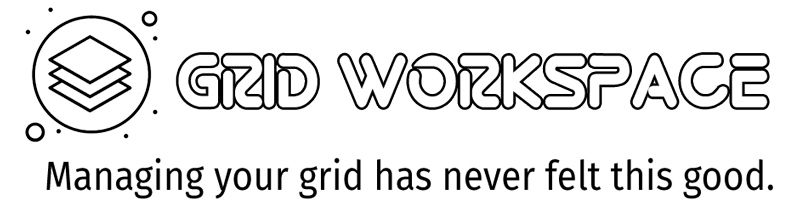

##  · [RU](README.ru.md)

Grid Workspace is an in-game editor for the block logic of a grid in Space Engineers. It draws
your ship as a **diagram** — cards for blocks, ports and lines — and writes every connection you
draw into the **real block toolbars**, so what you see on the diagram is what the game runs. The
conveyor network is drawn on the same diagram, read-only.

## Install

1. Copy the mod folder into `%APPDATA%\SpaceEngineers\Mods` (the folder must be named
   `GridWorkspace`), or
   subscribe on Steam Workshop.
2. In game: **Load Game** → select the world → **Mods** → enable `Grid Workspace` →
   load the world.

Install it **on the server and on every client**. Reading the diagram works anywhere; creating
links and watch bindings is server-only, and a remote client is refused with a reason.

## Open

1. Sit in a **cockpit** (any pilot seat).
2. Press **K** to open the terminal.
3. Press the **Grid Workspace** button.

The button exists only on cockpits: the editor needs a pilot seat to know which grid to show.

## Use

**What you see.** A card is a block: name, subtype and a row of buttons. A strip under the card
is a port: green dot on the right is an output (the block can report something), blue dot on the
left is an input (the block can be told to do something). A line is a link. Named groups from the
terminal are drawn as a frame behind their members.

**Move around.**

| Action | How |
|---|---|
| Move a card | left-drag the card |
| Pan the diagram | right-drag or middle-drag |
| Zoom | mouse wheel (around the cursor) |
| Find a block | `Search blocks` at the bottom |
| Jump to a block's terminal | the square-with-arrow icon on its card |
| Close | **Esc** or **Close** |

**Connect blocks.**

1. Press the bind icon (square with a plus) on the source card. A block with two independent
   lists shows two lamps instead: filled — "yes", outline — "no".
2. A line follows the cursor; click the target block.
3. Pick an action from the list.

Right-click cancels at any step. A port may have several sources; the list then shows
"sources: N".

**Remove a link.** The **"x"** on a port removes all links of that port. There is no way to
remove a single line — do that in the game terminal.

**Groups.** A group is a named block set from the terminal. It has inputs but no outputs, and
dragging it by the name strip moves all its cards together.

**Hide blocks.** Every terminal block has a **Show in Grid Workspace** checkbox. Turn it off and
the block and its lines disappear from the diagram — the connections keep working. The `[=]`
button at the bottom toggles hidden blocks, subgrids, grid borders and the conveyor network.

**Conveyor network.** Blocks joined by pipes are linked on the diagram by a **pipe in section**:
two thin lines in `#444455` with a gap between them, and rounded bends. Such a line does not mean
"these blocks are on the same ship" — it means "these two blocks are adjacent on the conveyor
network, with no other block of the diagram between them". Two consequences are visible in the
picture: a hidden block is walked through (the card is hidden, not the pipe), and a conveyor
junction that has a card becomes a point of intersection, with the neighbours' pipes meeting at
it. The network is only **shown**: a pipe cannot be created or removed from the editor — pipes are
blocks you build. The toggle is `Show conveyor network` in the `[=]` menu, on by default.

**Event controller.** The bell icon starts watch mode: click the block the controller should
watch. Up to 6 blocks per controller. The dashed yellow line means "watches", not "links".

## Limitations

1. **Blocks bound on the diagram are not listed in the controller's terminal** (Selected Blocks).
   The game keeps that list private; the controller still works and still fires.
2. **Only the server creates links and bindings.** In multiplayer, a remote client can look but
   not change.
3. **A link is a toolbar cell.** If the toolbar has no free cell, the mod says so and does not
   create one.
4. **A far block needs a transmitting antenna** to jump to its terminal — a game rule, not a mod
   rule. Close up, no antenna is needed.
5. **Hiding a block does not remove its connections.** Hiding is about the picture only.
6. **The conveyor network is display-only.** Pipe direction is not drawn: you see that blocks are
   connected, not which way a sorter passes items. And on a very dense network no more than a
   hundred pipes are drawn — the rest still work in the game, they are just not on the diagram.
7. **Large grids:** only what fits on screen is drawn. Zoom out, pan, or search.

## License

Icons — **Font Awesome Free 7.3.1**, © Fonticons, Inc., <https://fontawesome.com>, licensed
under **CC BY 4.0** (<https://fontawesome.com/license/free>). Font Awesome fonts (SIL OFL 1.1)
are not shipped. The rest of the mod's code belongs to the project.

---

Developer documentation: [`docs/`](docs/README.md).
