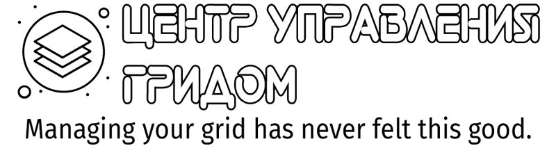

##  · [EN](README.md)

«Центр Управления Гридом» (ЦУГ) — внутриигровой редактор логики блоков грида в Space
Engineers. Он рисует корабль как **схему** — карточки блоков, порты и линии — и записывает
каждую нарисованную связь в **настоящие тулбары блоков**, так что на схеме видно ровно то,
что исполняет игра. Конвейерная сеть рисуется на той же схеме — только для чтения.

## Установка

1. Скопируйте папку мода в `%APPDATA%\SpaceEngineers\Mods` (папка должна называться
   `GridWorkspace`), или
   подпишитесь в Steam Workshop.
2. В игре: **Load Game** → выберите мир → **Mods** → включите `Grid Workspace` →
   загрузите мир.

Ставьте мод **на сервер и на всех клиентов**. Смотреть схему можно откуда угодно, но создавать
связи и привязки может только сервер: удалённому клиенту мод откажет и напишет причину.

## Как открыть

1. Сядьте в **кокпит** (или любое место пилота).
2. Нажмите **K**, чтобы открыть терминал.
3. Нажмите кнопку **«Центр Управления Гридом»**.

Кнопка есть только у кокпитов: редактору нужно место пилота, чтобы понять, чей грид показывать.

## Как пользоваться

**Что видно на схеме.** Карточка — это блок: имя, подтип и ряд кнопок. Полоска под карточкой —
порт: зелёная точка справа это выход (блок умеет что-то сообщать), синяя точка слева это вход
(блоку можно приказать что-то сделать). Линия — связь. Именованные группы из терминала
обведены рамкой позади своих участников.

**Перемещение.**

| Действие | Чем |
|---|---|
| Двигать карточку | потянуть её левой кнопкой |
| Двигать схему | правая или средняя кнопка и тянуть |
| Масштаб | колесо мыши (вокруг курсора) |
| Найти блок | строка `Поиск блока` внизу |
| Перейти в терминал блока | иконка «квадрат со стрелкой» на карточке |
| Закрыть | **Esc** или **Закрыть** |

**Создать связь.**

1. Нажмите иконку привязки (квадрат с плюсом) на карточке блока-источника. У блока с двумя
   независимыми списками вместо неё две лампы: залитая — «да», контурная — «нет».
2. За курсором потянется линия; кликните по блоку-получателю.
3. Выберите действие из списка.

Отмена на любом шаге — правая кнопка. На один порт можно повесить несколько источников: в
списке будет пометка «источников: N».

**Выполнить действие сейчас.** **Правый клик по карточке** открывает тот же список действий, но
строка выполняется **сразу** на этом блоке (у группы — на всех её участниках), и **связь не
создаётся**. Это разовое «нажать кнопку» из терминала, не выходя со схемы. Заголовок меню —
`Ручное действие`; правый клик по карточке с небольшим движением по-прежнему двигает схему.

**Удалить связь.** Кнопка **«x»** на порте удаляет **все** связи этого порта. Убрать одну
линию нельзя — это делается в терминале игры.

**Группы.** Группа — именованный набор блоков из терминала. У неё есть входы, но нет выходов;
за полосу имени её можно перетащить целиком, все карточки поедут вместе.

**Скрыть блоки.** У каждого терминального блока есть чекбокс **«Показывать в ЦУГ»**.
Выключите его — блок и его линии исчезнут со схемы, а связи продолжат работать. Кнопка `[=]`
внизу переключает скрытые блоки, субгриды, границы гридов и конвейерную сеть.

**Конвейерная сеть.** Блоки, соединённые трубами, связаны на схеме **трубой в разрезе**: две
тонкие линии цвета `#444455` с зазором между ними, изгибы скруглены. Такая линия означает не
«эти блоки на одном корабле», а «эти два блока соседние на конвейерной сети, и между ними нет
другого блока со схемой». Отсюда два следствия, которые видно на картинке: скрытый блок труба
проходит насквозь (прячется карточка, а не труба), а конвейерный соединитель, у которого есть
карточка, становится точкой пересечения — к нему сходятся трубы соседей. Сеть только
**показывается**: создать или удалить трубу из редактора нельзя, трубы — это построенные блоки.
Переключатель — `Показывать конвейерную сеть` в меню `[=]`, по умолчанию включён.

**Event controller.** Колокольчик включает режим отслеживания: кликните блок, за которым
контроллер должен следить. До 6 блоков на контроллер. Жёлтая пунктирная линия означает
«следит», а не «связан».

## Ограничения

1. **Блоки, привязанные на схеме, не видны в терминале контроллера** (Selected Blocks). Игра
   держит этот список закрытым; контроллер при этом работает и срабатывает.
2. **Связи и привязки создаёт только сервер.** В мультиплеере удалённый клиент может смотреть,
   но не менять.
3. **Связь — это ячейка тулбара.** Если свободных ячеек нет, мод скажет об этом и не станет
   создавать ячейку сам.
4. **К далёкому блоку нужна передающая антенна**, чтобы перейти в его терминал: это правило
   игры, а не мода. Вблизи антенна не нужна.
5. **Скрытие блока не удаляет его связи.** Скрытие — только про картинку.
6. **Конвейерная сеть только показывается.** Направление труб не рисуется: видно, что блоки
   соединены, но не то, куда именно пропускает предметы сортер. И на очень плотной сети
   рисуется не больше сотни труб — остальные трубы в игре работают, но на схеме их нет.
7. **Большие гриды:** рисуется только то, что попало на экран. Уменьшите масштаб, сдвиньте
   схему или воспользуйтесь поиском.

## Лицензия

Иконки — **Font Awesome Free 7.3.1**, © Fonticons, Inc., <https://fontawesome.com>, лицензия
**CC BY 4.0** (<https://fontawesome.com/license/free>). Шрифты Font Awesome (SIL OFL 1.1) в
мод не входят. Остальной код мода — собственность проекта.

---

Документация для разработчика: [`docs/`](docs/README.md).
