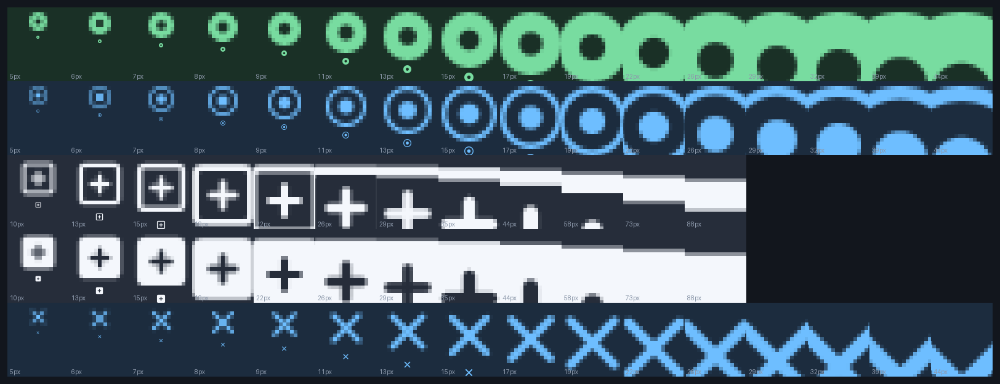
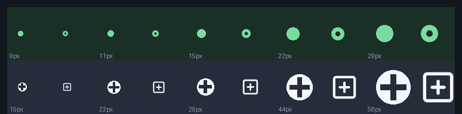

# Иконки Font Awesome в редакторе: чем рисовать и как не превратить их в «пиксели»

Дата проверки: 2026-11-22. Сборка игры: `1.211.017`
(`H:\SteamLibrary\steamapps\common\SpaceEngineers\Bin64`).
Исходники иконок: `data/fontawesome-free-7.3.1-desktop` (Font Awesome Free 7.3.1, в git не
хранится).

> **Область действия.** Это запись исследования, а не текущее решение. Исследование
> проводилось для трёх иконок (`circle-dot`, `square-plus`, `xmark`); сейчас мод поставляет
> **шесть**, и контролы карточки перерисованы иначе — см. [ADR-0020](../adr/0020-card-button-row.md)
> и каталог [`07-icon-catalog.md`](../07-icon-catalog.md). Упоминания `PlusButtonRadius`,
> `GroupButtonRadius`, `TryBindButton`, `DrawPlusButton` ниже описывают состояние на момент
> проверки; действующие константы и методы — `CardButtonDiameter`, `CardButtonRadius`,
> `PortGeometry.TryCardButton`, `VgsEditorScreen.DrawCardButton`.

Вопрос: можно ли поставить в редактор настоящие иконки Font Awesome —
`circle-dot` (Solid) вместо круга-«точки порта», `square-plus` (Regular) вместо «+» создания
исходящего порта и `xmark` (Solid) вместо «x» удаления связи — так, чтобы они подчинялись
тем же правилам размера, что и нынешние фигуры, и оставались гладкими на любом зуме.

Легенда та же, что в остальных документах: **[ПРОВЕРЕНО]** — проверено на этой машине
(рефлексия/IL по сборкам игры, чтение файлов игры, запуск прототипа); **[НЕ ПРОВЕРЕНО]** —
гипотеза, которую может подтвердить только запуск игры.

---

## 0. Короткий ответ

**Да, возможно.** Рабочих путей три, и они не равны по цене; выбор между ними — не вопрос
вкуса, а вопрос того, где живёт разрешение.

| Путь | Качество | Цена | Вердикт |
|---|---|---|---|
| **A. Заранее испечённая текстура** (SVG → маска → PNG → `GuiTextures.sbc` → `DrawPixels`) | иконка рисуется на любом масштабе; геометрия — только если текстуры нет | внешний конвейер сборки ассетов, бинарный файл в моде | **реализовано** — [ADR-0019](../adr/0019-icons-atlas.md) |
| **B. Растеризация в текстуру под точный размер** (`IMyGeneratedTextures` + `DrawPixels`) | точное 1:1, масштаба нет ни на одном шаге | ≈ 500 строк парсера и растеризатора в моде | равноценная замена, если не хочется бинарных ассетов |
| **C. Свой bitmap-шрифт** (BMFontGen → `Fonts.sbc` → `MyScreenSpaceText`) | зависит от испечённого размера атласа | готовый инструмент, но **шрифты инициализируются один раз при старте игры**, до загрузки мода (§9.3) — вероятный блокер | не рекомендую |
| **D. Геометрия примитивами** (`Disc`, `RectClipped`) | без сглаживания, ступеньки 1 px | нуль ассетов и нуль кода | запасной путь при отсутствии текстуры |

Главная поправка к первому варианту этого документа: **заранее испечённый растр — не тупик.**
Ранее здесь было сказано, что он «мылит или пикселит». Это верно только при *увеличении*
сверх испечённого разрешения. Текстура 256×256 покрывает весь диапазон редактора даже на 4K
(кнопка «+» там 175 px), и тогда работает только уменьшение.

**Вторая поправка, полученная в игре и отменяющая часть §9.2:** мип-цепочка не нужна, а DDS —
не тот контейнер. Оба утверждения ниже (§9.2, §8) были выведены из измерений на файлах и
оказались неполными: DXT5-файл с корректной альфой на всех мипах рисовался в
`MyScreenSpaceSprite` **непрозрачным квадом**, а PNG того же содержания — правильно. Риск «нет
мипов» при этом оказался меньше, чем думали: прямая симуляция сэмплера показывает, что кольцо
сохраняет отверстие даже на 5 px, а «квадрат с плюсом» читается с 9 px. Подробно —
[ADR-0019](../adr/0019-icons-atlas.md) §1 и §6.

Вторая поправка, найденная уже при реализации: **атлас из нескольких иконок не годится**, хотя
сам по себе растр годится. Мипы уменьшают и ячейку, и промежуток между ними, поэтому на
уровне, с которого рисуется иконка 15 px, соседняя ячейка подмешивается — измерено, таблица
в [ADR-0019](../adr/0019-icons-atlas.md) §4 контекста. Реализация поэтому использует
**отдельную текстуру на иконку**: у неё нет соседа, и вопрос отступа не возникает. Остальное
в варианте A — `GuiTextures.sbc` и `DrawPixels` — осталось как было; мипы и DXT5 отменены
второй поправкой выше, потому что без мипов подмешивания нет уже по построению.

[ПРОВЕРЕНО] почему отдельная текстура решает вопрос, а не откладывает его: спрайты рисуются
сэмплером из `MySamplerStateManager.StandardSamplers`, и **ни один из шести его сэмплеров не
`Wrap`** (`Default`, `Point`, `Linear`, `Texture` — `Clamp`; `Alphamask`, `AlphamaskArray` —
`Border`). Выборка за границей квада зажимается на краевой тексел, а он прозрачен по
построению. Подробности и IL — в ADR-0019 §4a.

---

## 0a. Что именно проверялось в этом документе

Вопрос был поставлен так: можно ли поставить в редактор настоящие иконки Font Awesome —
`circle-dot` (Solid) вместо круга-«точки порта», `square-plus` (Regular) вместо «+» создания
исходящего порта и `xmark` (Solid) вместо «x» удаления связи — так, чтобы они подчинялись
тем же правилам размера, что и нынешние фигуры, и оставались гладкими на любом зуме.

Легенда та же, что в остальных документах: **[ПРОВЕРЕНО]** — проверено на этой машине
(рефлексия/IL по сборкам игры, чтение файлов игры, запуск прототипа); **[НЕ ПРОВЕРЕНО]** —
гипотеза, которую может подтвердить только запуск игры.

**Ключевое различие между A и B, из-за которого B вообще имеет смысл:** ассет — это растр,
снятый один раз и потом масштабируемый. В B растр создаётся заново под каждый размер в
пикселях, и масштаба в конвейере нет ни на одном шаге; источник истины — кривые Безье,
зашитые в мод числами.

---

## 1. Что лежит в Font Awesome 7.3.1

[ПРОВЕРЕНО] чтением файлов пакета:

| Что | Значение |
|---|---|
| SVG-файлов | 2883: `solid` 2001, `regular` 273, `brands` 609 |
| `<path>` в файле | **ровно один** во всех 2883 файлах |
| Команды в `d` | только `M l c s a z` (без учёта регистра) во всех 2883 файлах |
| `viewBox` | высота всегда 512, ширина 384/448/512 |
| Шрифты | `otfs/*.otf` — три OTF (Solid 900, Regular 400, Brands) |

Нужные три иконки:

| Иконка | Стили | Кодовая точка | viewBox | длина `d` |
|---|---|---|---|---|
| `circle-dot` | solid, regular | `F192` | 0 0 512 512 | 92 (solid) / 139 (regular) |
| `square-plus` | solid, regular | `F0FE` | 0 0 448 512 | 307 (solid) / 416 (regular) |
| `xmark` | **только solid** | `F00D` | 0 0 384 512 | 279 |

Команда проверки:

```powershell
$fa = 'e:\Projects\!VGS\data\fontawesome-free-7.3.1-desktop\svgs'
Get-ChildItem $fa -Recurse -Filter '*.svg' | ForEach-Object {
    $x = Get-Content $_.FullName -Raw
    [regex]::Match($x, '\sd="([^"]+)"').Groups[1].Value
} | ForEach-Object { [char[]]$_ } | Where-Object { $_ -match '[A-Za-z]' } |
    Group-Object | Select-Object Name, Count
```

Практическое следствие: парсер SVG для этого набора — это `M/L/C/S/A/Z` плюс `H/V/Q/T` для
полноты; ни клип-путей, ни трансформаций, ни заливок-градиентов нет.

А вот **подобъектов в одном `d` несколько** — 10267 команд `M` на 2883 файла, в среднем 3,6
на иконку. Это не мелочь, а сама суть формы: отверстие — это второй подобъект с
противоположным направлением обхода. [ПРОВЕРЕНО] прототипом:

| Иконка | Подобъектов | Из чего |
|---|---|---|
| `circle-dot` Solid | 2 | внешний круг + отверстие |
| `circle-dot` Regular | 3 | внешний круг + внутренний круг + отверстие |
| `square-plus` Regular | 3 | внешний контур + внутренний контур рамки + плюс |
| `square-plus` Solid | 2 | квадрат + вырез плюса |
| `xmark` Solid | 1 | две пересекающиеся полосы как один контур |

Отсюда: заливка — **non-zero winding**, и отверстие получается само собой, без булевых
операций; но парсер, который склеит подобъекты в один контур или возьмёт `even-odd`, получит
сплошной диск вместо кольца. Это первое, что стоит проверить в любой реализации.

Лицензия: иконки Font Awesome Free — CC BY 4.0 (шрифты — SIL OFL 1.1). Атрибуция
обязательна, если пути попадут в исходники мода.

---

## 2. Что умеет API, разрешённый моду

[ПРОВЕРЕНО] IL установленных сборок через `tools/dump-se-il.ps1`; код игры не исполнялся.

### 2.1. Спрайт рисуется по имени материала, и генерируемая текстура — одно из имён

`Sandbox.ModAPI.MyScreenSpaceSprite.TryGetTexture` перебирает источники в таком порядке:

```
transparent material → LCD-текстура → GUI-текстура → иконка определения блока → сгенерированная текстура
```

последний шаг — `TryGetGeneratedTexture(material)` → `MyRenderProxy.IsGeneratedTextureAlive(name)`.
То есть материал, полученный из `IMyGeneratedTexture.MaterialId`, спрайт принимает наравне с
остальными. `Draw`/`DrawPixels`/`DrawPivoted` кладут запись в `MyScreenSpaceDrawQueue`,
откуда она уходит в `MyRenderProxy.DrawSpriteExt`.

### 2.2. Текстуру можно создать и обновить из мода

`VRage.Game.ModAPI.IMyGeneratedTextures` (`MyAPIGateway.GeneratedTextures`):

```csharp
IMyGeneratedTexture Create(string nameHint, Vector2I size, MyGeneratedTextureFormat format = Srgb)
// IMyGeneratedTexture: string Name; MyStringId MaterialId; Vector2I Size; int ByteCount; bool IsValid;
//                     byte[] BeginUpdate(); void EndUpdate(byte[] pixels);
```

[ПРОВЕРЕНО] IL `MySessionComponentGeneratedTextures`:

| Факт | Значение |
|---|---|
| Максимальная сторона текстуры | `MAX_TEXTURE_SIDE = 1024` |
| Бюджет на сессию | `MAX_SESSION_BYTES = 268435456` (256 МБ) |
| Формат буфера | RGBA8, `ByteCount = W*H*4` |
| Длина `nameHint` | обрезается до 32 символов, имя получает префикс `ModTex_<n>_` |
| `EndUpdate` с буфером неверной длины | пишет ошибку в лог и **не** обновляет текстуру |
| Обновление | `MyRenderProxy.UpdateGeneratedTexture(name, data, onConsumed)`; буфер возвращается в очередь повторно используемых |
| `MyGeneratedTextureFormat.Srgb` → | `MyGeneratedTextureType.RGBA` (Linear → `RGBA_Linear`) |

### 2.3. Сглаживание даёт сам конвейер, если текстура совпадает с пикселями 1:1

`Content\Shaders\Primitives\Sprites.hlsl` [ПРОВЕРЕНО] чтением файла игры:

```hlsl
// @define PREMULTIPLY_ALPHA
float4 sample = SpriteTexture.Sample(LinearSampler, input.texcoord0);
#ifdef PREMULTIPLY_ALPHA
    sample.rgb *= sample.a;
#endif
output = sample * input.color * mask;
```

Два следствия:

1. **В текстуру пишется прямой (straight) альфа, не премультиплицированный**: шейдер
   премультиплицирует сам. `RGB = 255` и `A = покрытие` — то, что нужно.
2. **Каналы RGB не важны**, пока они белые: цвет задаётся параметром `color` при рисовании,
   поэтому порядок каналов (RGBA/BGRA) на результат не влияет. Это снимает самый
   неприятный класс ошибок: «иконка вышла синей».

### 2.4. Вайтлист ничего не запрещает

[ПРОВЕРЕНО] `tools/check-whitelist.ps1 -Dump` (57 пространств имён, 273 типа, 15 членов для
ModApi). Всё нужное уже разрешено и уже используется модом:

| Что нужно | Пространство имён | Статус |
|---|---|---|
| `MyScreenSpaceSprite`, `MyScreenSpaceText`, `MyScreenSpace` | `Sandbox.ModAPI` (exact) | используется |
| `IMyGeneratedTextures`, `IMyGeneratedTexture`, `MyGeneratedTextureFormat` | `VRage.Game.ModAPI` (exact) | используется |
| `Vector2`, `Vector2I`, `Rectangle`, `Color` | `VRageMath` (exact) | используется |
| `MyStringId` | `VRage.Utils` (exact) | используется |
| `Dictionary<,>`, `List<>` | `System.Collections.Generic` (exact) | используется |
| `CultureInfo`, `NumberStyles` (парсер чисел SVG) | `System.Globalization` (exact) | разрешено |
| `Math`, `FormatException`, `StringBuilder` | `System.*` (типы) | разрешены |

Новых типов путь не требует, то есть `check-whitelist.ps1` не может покраснеть из-за него.

### 2.5. Почему нельзя обойтись текстом

[ПРОВЕРЕНО] чтением `Content\Fonts\*` и `Content\Data\Fonts.sbc`:

- шрифты игры — заранее испечённые атласы `FontData*.xml` + `FontData*.DDS` (DX10, 1024×1024,
  11 мип-уровней), объявленные как определения `FontDefinition` в `Fonts.sbc`;
- ни в `white\FontDataPA.xml`, ни в `white\FontDataCH.xml`, ни в `white\FontDataJP.xml`,
  ни в `monospace\FontDataPA.xml` нет глифов `F192`, `F0FE`, `F00D`;
- из проверенных «похожих» символов в `white` есть `×` (00D7), `□` (25A1) и `+` (002B);
  в `monospace` дополнительно `⊙` (2299), `●` (25CF), `○` (25CB), `■` (25A0), `✓` (2713).

То есть «просто нарисовать символ» не выйдет: символов нет. Свой `FontDefinition` — это
свой атлас в формате игры, то есть ровно тот заранее испечённый растр, который решено не
делать (и вдобавок формализовать чужой формат DDS+XML).

[ПРОВЕРЕНО] заодно видно, почему шрифт не годится и как замена иконки. Глифы в атласах
нарезаны `30x42` тексела (атлас 1024×1024, `size="23"`), а нужные размеры — 15 и 29 px при
зуме 1 и до 88 px при максимальном:

```
$g = 'H:\SteamLibrary\steamapps\common\SpaceEngineers'
Select-String "$g\Content\Fonts\monospace\FontDataPA.xml" -Pattern 'code="(2299|25cf|2713)"'
# <glyph ch="⊙" code="2299" ... size="30x42" ... />
```

Мелкие размеры такой глиф отдаст нормально (это downscale), крупные — растянет с 30×42, то
есть размылит, — ровно тот дефект, от которого уходим. По этой же причине `⊙` (U+2299,
«кружок с точкой») из `monospace` — не замена `circle-dot`: он и по форме другой (не кольцо),
и по природе растр.

---

## 3. Чем вообще можно нарисовать иконку: три класса решений

Полный перечень — в §7; здесь сравниваются три класса, потому что выбор между ними и есть
предмет спора. Обозначения совпадают с §0: **A** — атлас, **B** — растеризация под размер,
**D** — геометрия.

| | A. Текстура (DDS с мипами) | B. Растеризация под размер | D. Геометрия примитивами |
|---|---|---|---|
| Что происходит | текстура испечена один раз, при рисовании уменьшается по мипам | SVG-путь → полилинии → покрытие пикселей → RGBA-текстура `W×W` → спрайт 1:1 | контур аппроксимируется прямоугольниками и дисками |
| Сглаживание | есть (мипы + линейная фильтрация) | есть (покрытие + линейная фильтрация) | нет, ступеньки 1 px |
| Масштабирование растра | только уменьшение (256 px против 175 px на 4K) | нет | нет |
| Любая форма | да | да | только то, что собирается из прямоугольников и дисков |
| Новые типы в моде | нет | нет (всё уже разрешено) | нет |
| Стоимость в кадре | 0 | 0,05–0,3 мс при смене размера, потом 0 | до ~90 квадов на иконку каждый кадр |
| Что добавить в репозиторий | бинарный DDS + SBC + инструмент сборки | ≈ 500 строк C# | ничего |
| Риск | качество на мелких размерах — только при отсутствии мипов (§9.2); несколько иконок в одном файле не годятся (§0) | объём кода; путь «текстура → спрайт» проверен по IL, но не глазами в игре | ступеньки видны, и это ровно то, что просили избежать |

Класс D заслуживает отдельного уточнения, потому что он единственный **полностью
безтекстурный**. Форму он передаёт без потерь — `Disc` уже так рисует точку порта, «+» —
двумя прямоугольниками, — но край остаётся ступенчатым: `Disc` кладёт по одной полосе на
пиксель, и это честные 1 px ступеньки, а не сглаживание. `xmark` — две диагональные полосы;
их можно залить построчно теми же горизонтальными полосами. Это работоспособно и дёшево, но
именно этот результат и называется «пиксельно», поэтому D — запасной путь, а не основной.

---

## 4. Класс B: растеризация под размер — прототип и измерения

Этот раздел описывает вариант B не потому, что он выбран, а потому, что он **измерен**:
прототип работает, и на его числах держится сравнение с атласом в §9.2.

Прототип лежит в `tools/icon-proto/` (в мод не входит, это стенд):

| Файл | Что делает |
|---|---|
| `IconGeometry.cs` | парсер `d` → контуры (`M L H V C S Q T A Z`, `s`/`a`/`c` в относительной форме), уплощение кривых с допуском в единицах viewBox |
| `IconRaster.cs` | растеризация в альфа-маску: горизонтальные пролёты считаются аналитически, строка сэмплируется 8 раз, правило non-zero |
| `Program.cs` | стенд: растеризует три иконки во все размеры 4…96 px плюс 128 и 256, пишет PGM и `report.csv`, сверяет площадь с аналитической |
| `run.ps1` | компилирует стенд тем же Roslyn и теми же ссылками, что `verify-compile.ps1`, и запускает |
| `compare.py` | сверка с FreeType (рендер того же OTF) — независимая проверка геометрии |
| `atlas_compare.py` | атлас с мипами и без против растеризации под размер (§9.2) |
| `preview.py` | контактные листы для проверки глазами: иконки на цветах редактора, в 6× и 1:1 |

### 4.1. Что измерено

[ПРОВЕРЕНО] запуском стенда на этой машине:

| Иконка | Точек контура (15 px / 29 px) | Время разбора+растеризации | Отклонение площади от аналитической |
|---|---|---|---|
| `circle-dot` solid | 50 / 74 | 0,09 / 0,22 мс | ≤ 0,2 % |
| `circle-dot` regular | 83 / 107 | 0,13 / 0,26 мс | ≤ 0,5 % |
| `square-plus` regular | 59 / 75 | 0,10 / 0,20 мс | ≤ 2,5 % (и только на 5–17 px) |
| `square-plus` solid | 46 / 62 | 0,08 / 0,17 мс | ≤ 0,5 % |
| `xmark` solid | 25 / 41 | 0,05 / 0,12 мс | ≤ 2,0 % (только 4 px) |

Площадь считается независимо (формула шнурков по контурам, со знаком: внешние контуры
противоположны отверстиям). Совпадение двух независимых величин означает, что дуги
разворачиваются в правильную сторону и отверстие остаётся отверстием — самая частая ошибка
при разборе SVG.

[ПРОВЕРЕНО] `compare.py` против FreeType: расхождение по площади 3–9 %, и оно объясняется
тем, что FreeType рисует глиф в em-квадрате шрифта, а прототип вписывает viewBox в квадрат
(у FA ширина меньше высоты). Форма при этом совпадает — контуры, дуги и отверстия
воспроизводятся.

### 4.2. Как это выглядит





Оба листа сделаны из реальных масок прототипа на реальной палитре `VgsEditorScreen`
(`ColNode`, `ColPortOutFill`, `ColPlusFill`), в размерах, которые редактор действительно
выдаёт. Пересобрать: `pwsh -File tools/icon-proto/run.ps1` затем
`python tools/icon-proto/preview.py`.

Чего в этих картинках **нет**: сглаживания от GPU. Маски уже содержат частичное покрытие
краёв, а рисование 1:1 с линейной фильтрацией его не портит; но проверить это можно только
в игре.

### 4.3. Бюджет: память и кадр

Размер текстуры — целое число пикселей, поэтому за весь диапазон зума одна иконка проходит
десятки размеров: 5…44 px для точки порта (40 значений), 10…88 px для «+» (79 значений),
6…51 px для T/F (46 значений).

| Статья | Оценка | Откуда |
|---|---|---|
| Память, точка порта, весь диапазон | ≈ 117 КБ | `Σ W²·4` по 5…44 px |
| Память, «+», весь диапазон | ≈ 923 КБ | `Σ W²·4` по 10…88 px |
| Память, T/F, весь диапазон | ≈ 182 КБ | `Σ W²·4` по 6…51 px |
| **Итого на все три вида контролов** | **≈ 1,2 МБ** | против бюджета сессии 256 МБ (`MAX_SESSION_BYTES`) |
| Растеризация одного размера | 0,05–0,3 мс | измерено, см. §4.1 |
| Худший кадр (зум двигается, три контрола сменили размер) | ≈ 1 мс | 3 × 0,3 мс |

То есть в установившемся режиме стоимость нулевая, а платится она только в тех кадрах, где
размер действительно изменился. При желании шаг квантуется до 2 px — вчетверо меньше
памяти (квадратичная зависимость), и цена — расхождение до 1 px между текстурой и квадом
(то есть ровно то размытие, которого избегаем; поэтому по умолчанию шаг 1 px).

---

## 5. Правила размера: те же, что у нынешних фигур

[ПРОВЕРЕНО] по `VgsConstants` и `PortGeometry`:

| Что | Формула | 1080p, зум 1 | 1080p, 0,35…3,0 |
|---|---|---|---|
| Диаметр точки порта | `2 · PortControlRadius · zoom · H` = `0,0135 · H · zoom` | 14,6 px | 5,1 … 43,7 px |
| Диаметр кнопки «+» | `2 · PlusButtonRadius · zoom · H` = `0,027 · H · zoom` | 29,2 px | 10,2 … 87,5 px |
| Диаметр кнопки T/F | `2 · GroupButtonRadius · zoom · H` | 17,1 px | 6,0 … 51,3 px |
| Высота полосы порта | `PortBarHeight · H` | 19,4 px | — |

Отсюда правила, которые надо соблюсти, и они совпадают с нынешними:

1. **Размер иконки выводится из того же радиуса**, а не из своего числа: сторона квадрата
   иконки = `2 · radius · zoom · H` (для точки порта — ровно диаметр, потому что внешняя
   окружность иконки и есть точка; для значка внутри белого диска — 0,75–0,8 диаметра).
2. **Центр не меняется.** `PortGeometry.TryPortDot` / `TryBindButton` остаются источником
   истины; иконка рисуется в тот же центр.
3. **Попадание не меняется.** `PortControlHitTolerance` считается от того же радиуса.
4. **Пиксель — единица размера.** Destination-прямоугольник задаётся в целых пикселях, и
   текстура (A) или растр (B) подгоняется под него, а не наоборот: при A размер текстуры
   фиксирован и иконка уменьшается по мипам до целого размера, при B растр создаётся ровно
   этого размера. Дробная позиция недопустима в обоих случаях — фильтр размажет иконку на
   полпикселя.
5. **Порога читаемости нет — это отменено после приёмки в игре.** Здесь стояло, что ниже
   своего порога (11 / 12 / 9 px) контрол падает на геометрию. В игре это выглядело как
   дефект: форма контрола менялась при зуме. Измерение прямой симуляцией сэмплера (билинейная
   выборка 2×2 тексела, без мипов) показывает, что формы выживают намного ниже: у `circle-dot`
   отверстие 0,375 диаметра сохраняется даже при 5 px, `square-plus` читается с 9 px, `xmark` —
   с 3 px. Поэтому иконка рисуется на любом масштабе, а откат на геометрию остаётся только при
   отсутствии текстуры. Подробно — [ADR-0019](../adr/0019-icons-atlas.md) §6.

Пункт 4 требует аккуратности: в `VgsScreenDraw` для этого нужен `DrawIconPixels` (снап
позиции и размера в целые пиксели через уже имеющийся `MyScreenSpace.GetSafeGuiArea` и
`DrawPixels`), а не переиспользование `Draw` с дробной нормализованной позицией.

---

## 6. Что остаётся [НЕ ПРОВЕРЕНО]

Таблица относится к варианту B; для A проверок меньше — они в §9.1 и §8 (мипы, отступы,
регистрация), и все они подтверждены IL или ванильными файлами игры, кроме одной:
«`GuiTextures.sbc` мода действительно подхватывается» — это следует из IL
`MyGuiTextures.Reload` (перебор **всех** определений) и из вызова `Reload` в
`MySandboxGame.PerformPreload`, но проверяется только запуском.

| Утверждение | Как проверить |
|---|---|
| Спрайт действительно принимает материал сгенерированной текстуры в игре (IL говорит «да», но IL не рисует) | открыть редактор, увидеть иконку на месте точки порта |
| Прямой альфа канал не даёт тёмной каймы (если ожидается премультиплицированный — края потемнеют) | глазами на светлом диске: кайма по краю `xmark` |
| Снап в целые пиксели достаточен при динамическом разрешении и UI-масштабе | сменить разрешение при открытом редакторе, посмотреть на иконку |
| Текстура доступна спрайту **в том же кадре**, в котором создана | крутить зум от минимума до максимума и обратно |

Последний пункт — единственный, у которого есть неприятный режим отказа, и его стоит
закрыть заранее. [ПРОВЕРЕНО] по IL: `Create` вызывает `CreateOnRenderer` синхронно и с
`immediatelyReady = true`, а `MyScreenSpaceSprite.IsMaterialAvailable` проверяет
`MyRenderProxy.IsGeneratedTextureAlive`. Но рисование идёт через очередь
(`MyScreenSpaceDrawQueue`), а создание текстуры — отдельным сообщением рендеру, и порядок
двух сообщений в одном кадре IL не фиксирует. Если порядок окажется неудачным, спрайт
пропустится целиком (`IsDrawable` вернёт `false`), и иконка мигнёт на один кадр при каждой
смене размера.

Лечится дёшево и без догадок: рисовать иконку только когда
`MyScreenSpaceSprite.IsMaterialAvailable(material)` истинно, а иначе — падать на нынешнюю
геометрию (`Disc` / два прямоугольника). Тогда худший исход — один кадр со старой фигурой,
а не пустое место. Это же условие закрывает и случай, когда платформа не поддерживает
`IMyGeneratedTextures` (`IsSupported == false`, например `SkipRenderMessages`).

Все четыре пункта — наблюдения в игре, и у всех есть мягкий отказ: в худшем случае иконка
будет чуть мыльной, чуть тёмной по краю или на кадр сменится геометрией, а не сломается.

---

## 7. Полный перечень вариантов

Ниже — все способы, которые вообще существуют в этой сборке игры, включая те, что не
попали ни в первую редакцию этого документа, ни в альтернативное предложение (§9).

| № | Способ | Чем рисуется | Качество | Цена |
|---|---|---|---|---|
| **A** | Текстура **PNG** на иконку, зарегистрированная в `GuiTextures.sbc` | `MyScreenSpaceSprite.DrawPixels` (source-прямоугольник) | на любом масштабе; форма не меняется при зуме | внешний конвейер ассетов |
| A′ | Текстура через `TransparentMaterials.sbc` | то же | то же | то же, плюс `TextureType=FileTexture`, `UseAtlas=false` |
| A″ | Текстура в **DDS** (DXT5 с мипами) | то же | **проверено в игре: рисуется непрозрачным квадом**, хотя файл корректен | без конвертации |
| **B** | Растеризация контура **под точный размер** в `IMyGeneratedTexture` | `DrawPixels` 1:1 | точное, масштаба нет | ≈ 500 строк в моде |
| B′ | То же, но **один атлас на размер** (много иконок в одной текстуре) | `DrawPixels` + source | как B | меньше текстур, тот же код |
| **C** | Свой **bitmap-шрифт** (`Tools\Fonts\BMFontGen.exe` → `Fonts.sbc`) | `MyScreenSpaceText.Draw` | зависит от испечённого размера | инициализация шрифтов не доходит до модов (§9.3) |
| **D** | **Геометрия** существующими примитивами | `Disc`, `RectClipped` | ступеньки 1 px | нуль ассетов, нуль нового кода |
| E | Иконки **самой игры**: `Textures\GUI\Icons\buttons\IconCross.dds`, `IconCircle.dds`, `IconSquare.dds` | `DrawPixels` по имени GUI-текстуры | 32×32 — хватает только точке порта | нуль ассетов, но это не FA |
| F | **Иконка определения блока** — `MyScreenSpaceSprite` принимает строку `TypeId/SubtypeId` и берёт `definition.Icons[0]` | `Draw` | как у игры | для карточек блоков, не для кнопок |
| G | **Композитные GUI-текстуры** (`MyObjectBuilder_CompositeTexture` в `GuiTextures.sbc`) | `MyGuiTextures.GetCompositeTexture` | — | склейка частей; для трёх иконок не нужно |
| H | **LCD/текстовая поверхность** (`IMyTextSurface` + `MySprite`) | спрайты в мире | — | не полноэкранный редактор |
| I | **Билборды** (`MyTransparentGeometry`, `MyBillboard`) | мировое пространство | — | нужен свой очередь и ввод; не тот инструмент |

Вариант F — единственная находка, которая полезна независимо от выбора: `TryGetDefinitionIcon`
разбирает `MyDefinitionId` и отдаёт `Icons[0]` определения, то есть карточки блоков могут
показывать настоящие иконки блоков без единого нового ассета. Кнопкам это не помогает.

---

## 8. Что из этого следует для VGS

**По умолчанию — A.** Текстура 256 px на иконку (по файлу на иконку, не общий атлас — §0), PNG
без мип-цепочки, `GuiTextures.sbc`, `DrawPixels` с целочисленным destination. Это меньше кода,
чем B, и по качеству не хуже на тех размерах, где иконка вообще рисуется.

Обязательные детали, без которых A ломается:

1. **PNG, а не DDS.** Это пересмотрено после приёмки в игре и противоречит §9.2, который
   предполагал DDS с мипами. DXT5-файлы были корректны на диске (два независимых декодера
   читали чистую альфу на всех мипах) и всё равно рисовались в спрайте непрозрачным квадом;
   те же иконки в PNG работают. Подробно, с таблицей проверок — [ADR-0019](../adr/0019-icons-atlas.md) §1.
2. **Одна иконка на файл.** Не отступы между ячейками, а отсутствие ячеек: на грубом мипе
   промежуток схлопывается, и сосед подмешивается (измерено; [ADR-0019](../adr/0019-icons-atlas.md)
   §4 контекста). Сэмплер спрайтов — `Clamp`, поэтому за границей текстуры выборка зажимается
   на прозрачный край (ADR-0019 §4a). Отступ 8 px от края нужен всё равно — чтобы этот край
   был прозрачным.
3. **Целочисленный destination.** Дробная позиция заставляет фильтр размазывать иконку.
4. **Имя с префиксом `VGS_`**, чтобы не столкнуться с `SubtypeName` ванильных GUI-текстур.
5. **Прямой (straight) альфа.** Не премультиплицированная — см. §9.4.

**Если бинарные ассеты в моде нежелательны — B.** Прототип уже работает (§4), стоимость
измерена, API проверен по IL.

**Порога читаемости нет.** Отдельный «режим D ниже порога» существовал в первой редакции и
отменён после приёмки в игре: смена формы при зуме читается как дефект, а симуляция реального
сэмплера показывает, что формы читаются и на 5–9 px. Иконка рисуется на любом масштабе;
геометрия — только если текстуры нет. См. [ADR-0019](../adr/0019-icons-atlas.md) §6.

**C — не брать**, пока не доказано обратное в игре (§9.3).

### 8.1. Что именно меняется на экране

| Место | Сейчас | Станет |
|---|---|---|
| Точка порта (`DrawPortBar`) | сплошной диск цвета порта | `circle-dot` Solid — кольцо того же диаметра, того же цвета |
| Кнопка привязки (`DrawPlusButton`) | белый диск с вырезанным «+» из двух прямоугольников | `square-plus` **Regular** — контурный квадрат с плюсом, светлый, на месте диска |
| Удаление связи (`DrawPortRemoveButton`) | белый диск с буквой «x» из шрифта | `xmark` Solid — белый крест на месте диска |

Обратить внимание: `square-plus` Regular — **контурный** (тонкая рамка), а нынешняя кнопка —
сплошной белый диск. Это не замена один-в-один: у кнопки привязки меняется не только значок,
но и заливка. Если сплошной диск нужен для заметности, это `square-plus` **Solid** — он в
наборе есть, и на контактном листе (§4.2) показаны оба варианта подряд.

Это изменение поведения, видимого игроку, поэтому ему нужен ADR (замена/дополнение
[ADR-0014](../adr/0014-port-remove-button-and-port-look.md)) — до кода, а не после.
Лицензия Font Awesome Free — CC BY 4.0, атрибуция нужна в `README.md` и `metadata.mod`.

### 8.2. Где живёт разрешение (главное различие A и B)

| | A (текстура с мипами) | B (растеризация) |
|---|---|---|
| Максимальный размер иконки на 4K | 175 px («+»), текстура 256 px — запас 1,5× | любой, точно |
| Максимальный размер на 8K | 350 px — текстура 256 px уже мала, нужна 512 | любой, точно |
| Память | 3 × 256² × 4 ≈ 786 КБ (с мипами ≈ 1 МБ), фиксировано | ≈ 1,2 МБ за весь диапазон зума (§4.3) |
| Новый размер при зуме | ничего не происходит | 0,05–0,3 мс, кэшируется |
| Новая иконка | положить svg и пересобрать инструментом | добавить строку `d` |
| Бинарный ассет в моде | да | нет |
| Разрешение выше 8K | нужен файл 512 px | не меняется |

Заметить: по памяти варианты примерно равны — «текстура экономит память» здесь неверно,
потому что она хранит 256 px на иконку, а растеризация — весь диапазон зума. Экономия
текстуры в другом: она не требует кода в моде.

### 8.3. Как собрать текстуру для варианта A (без внешних кодировщиков)

[ПРОВЕРЕНО] `texconv.exe` в установке игры нет, поэтому DDS пишется сам. Какие форматы
игра действительно принимает — видно по её собственным GUI-текстурам:

| Файл | Размер | Мипы | Формат |
|---|---|---|---|
| `Icons\buttons\IconCross.dds` | 32×32 | 6 | DXT5 |
| `Icons\buttons\SquareButton.dds` | 64×64 | 1 | uncompressed |
| `screens\CenterGScreen.dds` | 1024×1024 | 11 | DXT1 |
| `screens\camera_overlay.dds` | 3840×2160 | 12 | BC7 (DXGI 99) |

Команда проверки:

```powershell
$py = '<python>'
& $py -c "import struct;b=open(r'...\IconCross.dds','rb').read(148);print(b[84:88], struct.unpack('<7I',b[4:32]))"
```

Практический вывод: **DXT5 с мип-цепочкой** — доказанно рабочий формат для иконок с альфой
(ванильный `IconCross` именно такой), и он же экономит память вчетверо против RGBA8.
Кодировщик DXT5 пишется в инструменте сборки; для плоской иконки с альфой он прост
(блок 4×4, две крайние точки альфы + интерполяция). Несжатый BGRA8 с мипами был написан как
запасной вариант и **удалён**: квантизация альфы в DXT5 на этих иконках — средняя ошибка
0,14/255 при максимуме 18/255, то есть запасной путь не понадобился, а непроходимый шлюзом
режим сборки хуже его отсутствия.

Предлагаемый конвейер (вне мода, в `tools/`) — **так и сделано**:

1. `tools/build-icon-atlas.ps1` — берёт `.svg` из `tools/icon-atlas/icons/` (по списку
   `icons.txt`), растеризует каждую в маску 256 px тем же `IconRaster`, строит мип-цепочку,
   пишет `Icons\<Id>.dds` **на каждую иконку** и `GuiTextures.sbc`;
2. артефакты кладутся в `src/GridWorkspace.Mod/Textures/VGS/Icons/` и `src/GridWorkspace.Mod/Data/`, плюс
   генерируется `Ui/VgsIconAtlas.g.cs`;
3. мод в рантайме знает только `MyStringId` на иконку и размер её текстуры.

Добавление иконки — строка в `icons.txt` и пересборка.

Форма `GuiTextures.sbc` мода (сверено с ванильным `Content\Data\GuiTextures.sbc`, где одно
определение `Base` и 233 текстуры):

```xml
<?xml version="1.0"?>
<Definitions xmlns:xsi="http://www.w3.org/2001/XMLSchema-instance"
             xmlns:xsd="http://www.w3.org/2001/XMLSchema">
  <Definition xsi:type="MyObjectBuilder_GuiTextureAtlasDefinition">
    <Id Type="MyObjectBuilder_GuiTextureAtlasDefinition" Subtype="VGS_Icons"/>
    <Textures>
      <Texture>
        <SubtypeName>VGS_CircleDot</SubtypeName>
        <Path>Textures\VGS\Icons\CircleDot.dds</Path>
      </Texture>
      <Texture>
        <SubtypeName>VGS_SquarePlus</SubtypeName>
        <Path>Textures\VGS\Icons\SquarePlus.dds</Path>
      </Texture>
    </Textures>
  </Definition>
</Definitions>
```

Один файл на имя — как в ванильном файле (233 записи на 231 файл). Несколько `<Texture>` с
одним `Path` и разными `SubtypeName` механизм тоже позволяет, и именно так выглядел первый
вариант решения — но он был отброшен: общий файл означает общий атлас, а атлас не переживает
мипы (§0 и [ADR-0019](../adr/0019-icons-atlas.md) §4 контекста).

### 8.4. Откуда мод берёт контур (только для варианта B)

Два варианта, и первый проще:

1. **Строки в исходниках.** Три `d` — 92, 416 и 279 символов, всего ≈ 0,8 КБ. Разбираются один
   раз при первом обращении. Никакого ввода-вывода, никакой зависимости от того, как игра
   упаковала мод, никакой возможности «файл не найден» в чужой сборке.
2. **Файлы `.svg` в папке мода.** [ПРОВЕРЕНО] типы для этого разрешены:
   `MyAPIGateway.Utilities` (`VRage.Game.ModAPI.IMyUtilities`) даёт
   `ReadFileInModLocation(string, ModItem)` и `FileExistsInModLocation`, а `ModItem` —
   это `VRage.Game.MyObjectBuilder_Checkpoint+ModItem`, пространство `VRage.Game` разрешено
   целиком. Плюс: иконку можно заменить, не трогая код. Минус: `[НЕ ПРОВЕРЕНО]` цепочка
   «найти свой `ModItem` в `MyAPIGateway.Session.Mods`» — ещё одна вещь, которая может
   отказать в чужой установке (пиратская копия, локальная папка, Steam Workshop), и тогда
   иконки просто не будет.

Для трёх иконок вариант 1 предпочтителен: 0,8 КБ строк дешевле, чем класс отказов, который
они не покрывают.

---

## 9. Проверка альтернативного предложения

Предложение (SVG → PNG → DDS-атлас → `MyScreenSpaceSprite.DrawPixels`, плюс Font Awesome как
игровой шрифт, плюс генерация текстур в рантайме) проверено пункт за пунктом по сборкам и
файлам игры.

### 9.1. Утверждения: что верно, что нет

| Утверждение | Вердикт | Чем |
|---|---|---|
| `MyScreenSpaceSprite` рисует текстурированные прямоугольники с цветом, вращением и масштабом | **верно** | сигнатуры, §2.1 |
| Свои текстуры мода регистрируются через `TransparentMaterials.sbc` | **верно, но с условиями**: `TextureType` должен быть `FileTexture` (значение 0, в ванильном файле не пишется), `UseAtlas` — `false` | IL `MyScreenSpaceSprite.TryGetTransparentMaterialTexture`; ванильный `Content\Data\TransparentMaterials.sbc`: 188 `.dds`, 170 `UseAtlas=false` |
| Для GUI правильнее `GuiTextures.sbc` | **верно, и это дешевле**: `MyGuiTextures.Reload` перебирает **все** определения `MyGuiTextureAtlasDefinition`, а `MySandboxGame.PerformPreload` вызывает его на загрузке мира — то есть модовые текстуры подхватываются | IL `MyGuiTextures.Reload`, `Sandbox.MySandboxGame` |
| `DrawPixels` позволяет взять прямоугольник из атласа | **верно** | `DrawPixels(material, Rectangle destination, Nullable<Rectangle> source, ...)` |
| Цветовой множитель даёт состояния normal/hover/disabled без отдельных картинок | **верно** | параметр `Color` в `Draw`/`DrawPixels` |
| Font Awesome как игровой шрифт — «практически без ручной обработки» | **в основном неверно**: шрифты инициализируются один раз при старте игры, до загрузки мода | §9.3 |
| Инструмент для шрифтов лежит в `Tools` | **верно**: `Tools\Fonts\BMFontGen.exe`, `MakeFontData.bat`, `Options.txt` (в нём видно и `-range`, и `-custom <код> <png>`) | чтение файлов игры |
| Конвертировать DDS «штатным `texconv.exe` из Tools» | **неверно**: `texconv.exe` в установке нет; есть `Tools\Space texture converter\TextureBuilder.exe`, и его readme говорит, что он работает только с `.dds` | чтение файлов игры |
| Формат BC7 обязателен | **неверно**: BC7 не требуется. Ванильные GUI-текстуры — 128 `.png` и 105 `.dds`; для GUI работает и PNG | `GuiTextures.sbc` |
| В генерируемую текстуру надо писать **премультиплицированную** альфу | **неверно, это двойное умножение**: шейдер премультиплицирует сам, и спрайт вызывается с `premultipliedAlpha: true`. В текстуру пишется прямой альфа | `Sprites.hlsl` (`@define PREMULTIPLY_ALPHA`, `sample.rgb *= sample.a`); IL `MySpritesRenderer.ProcessDrawMessage` → `AddSingleSprite(..., ldc.i4.1, ...)` |
| `MyGuiDrawAlignEnum.Center` | **такого члена нет**: перечисление состоит из `HORISONTAL_*_AND_VERTICAL_*`, центральное выравнивание — `HORISONTAL_CENTER_AND_VERTICAL_CENTER` | дамп `VRage.Utils.MyGuiDrawAlignEnum` |
| Слой `BelowHud` | **для модального редактора неверно**: он рисуется под HUD. Редактор уже использует `AboveHud` | ADR-0008, `VgsScreenDraw.Layer` |
| `IsSupported` надо проверять; на выделенном сервере отрисовки нет | **верно** | IL `MySessionComponentGeneratedTextures.get_IsSupported`, `MyScreenSpaceDrawQueue.CanDraw` |
| `MyModScreen` не даёт готовых контролов | **верно**, это уже известно проекту | ADR-0008 |

### 9.2. Измерено: атлас против растеризации под размер

Стенд `tools/icon-proto/atlas_compare.py` берёт маску 256 px (ячейка атласа, достаточная для
4K) и получает из неё 5…29 px тремя способами: растеризацией контура под размер, уменьшением
с мип-цепочкой (box-фильтр) и билинейной выборкой без мипов (2×2 тексела, как у PNG без
мипов). Сравнивается заливка (сумма альфы) и «шершавость» края.

| Иконка | Размер | Растеризация под размер | Атлас + мипы | Атлас без мипов |
|---|---|---|---|---|
| `circle-dot` Solid | 5 px | 16,7 | 16,9 (+1,2 %) | 20,0 (+19,9 %) |
| `circle-dot` Solid | 15 px | 151,4 | 151,9 (+0,3 %) | 154,8 (+2,2 %) |
| `circle-dot` Solid | 29 px | 565,2 | 568,9 (+0,7 %) | 569,6 (+0,8 %) |
| `xmark` Solid | 9 px | 18,5 | 18,5 (+0,3 %) | 13,0 (−29,6 %) |
| `xmark` Solid | 29 px | 193,0 | 191,9 (−0,6 %) | 185,2 (−4,1 %) |
| `square-plus` Regular | 9 px | 27,6 | 28,3 (+2,4 %) | 5,8 (**−79,2 %**) |
| `square-plus` Regular | 5 px | 8,4 | 8,7 (+4,3 %) | 20,0 (**+139,2 %**) |
| `square-plus` Regular | 29 px | 292,2 | 300,1 (+2,7 %) | 304,7 (+4,3 %) |

Вывод: **атлас с мипами эквивалентен растеризации под размер** (расхождение ≤ 4 % на всём
диапазоне), а без мипов ломается именно на тех размерах, где иконка и так на грани. Значит
спор «атлас или рантайм» — не про качество, а про то, где живёт разрешение и сколько кода
допустимо.

### 9.3. Почему шрифт Font Awesome, скорее всего, не заработает в моде

[ПРОВЕРЕНО] по IL: `MyGuiManager.InitFonts()` перебирает **все** определения
`MyFontDefinition` и для каждого зовёт `MyRenderProxy.CreateFont` — то есть именно этот
вызов и делает шрифт доступным для `MyScreenSpaceText.IsFontAvailable`. Вызывается
`InitFonts()` ровно из двух мест:

- `MyGuiManager.LoadContent()` — один раз при старте приложения, до загрузки мира и модов;
- `MyGuiManager.set_CurrentLanguage(...)` — при смене языка в настройках.

Ни `MySandboxGame.PerformPreload` (который перезагружает **GUI-текстуры**), ни загрузка
сессии шрифты не переинициализируют. Значит модовый `Fonts.sbc` в момент `LoadContent` ещё
не существует, и его `MyFontDefinition` до `CreateFont` не доходит.

`[НЕ ПРОВЕРЕНО]` окончательно — только запуском: если после загрузки мира с модом
`MyScreenSpaceText.IsFontAvailable("VGSIcons")` вернёт `true`, блокер снят. Проверяется
одной строкой в лог при открытии редактора.

Практический вывод: путь C нельзя рекомендовать как «самый простой», пока это не проверено,
а проверка стоит одного запуска игры — дороже, чем весь атлас.

### 9.4. Про премультиплицированную альфу

Две независимые проверки, и обе говорят одно: **текстура должна быть с прямым альфой**.

1. `Content\Shaders\Primitives\Sprites.hlsl`, первая строка — `// @define PREMULTIPLY_ALPHA`,
   а в пиксельном шейдере:
   ```hlsl
   float4 sample = SpriteTexture.Sample(LinearSampler, input.texcoord0);
   #ifdef PREMULTIPLY_ALPHA
       sample.rgb *= sample.a;
   #endif
   output = sample * input.color * mask;
   ```
   Шейдер умножает **саму выборку** на её альфу. Если в текстуре уже лежит премультиплицированный
   цвет, умножение происходит дважды и край иконки темнеет.
2. `MySpritesRenderer.ProcessDrawMessage` для `MyRenderMessageDrawSpriteExt` передаёт в
   `AddSingleSprite(..., premultipliedAlpha, ...)` константу `true` — то есть режим смешивания
   выбран под премультиплицированный результат, который получается **после** шейдера.

Это же относится и к B: в буфер `IMyGeneratedTexture` пишется `RGB = 255`, `A = покрытие`
(так и делает прототип, `IconRaster.RenderWhiteRgba`).

### 9.5. `DrawPixels` живёт в другой системе координат, чем `Draw`

[ПРОВЕРЕНО] по IL — и это ловушка, которой нет ни в одном из предложений:

| Метод | Что делает с координатами |
|---|---|
| `Draw(material, normalizedPosition, normalizedSize, ...)` | `GetScreenCoordinateFromNormalizedCoordinate(pos, false)` — нормализованные 0..1 превращаются в пиксели safe-GUI |
| `DrawPixels(material, Rectangle destination, ...)` | **никакого преобразования**: прямоугольник уходит в очередь как есть |

То есть `DrawPixels` принимает **пиксели окна**, а не нормализованные координаты и не пиксели
safe-GUI. Редактор раскладывает всё в нормализованных координатах клиентской области, поэтому
переход обязателен, и он уже есть: `VgsScreenDraw` держит `_apiScaleX/_apiOffsetX` и
`_clientHeightPixels` (ADR-0009). Использовать `MyScreenSpace.NormalizedToPixels` **нельзя** —
он считает от safe-GUI и на 16:9 даст сдвиг на ширину боковой полосы.

Отсюда правило для любого из вариантов: иконка рисуется через `DrawPixels` в пикселях окна,
снапнутых до целых, и никогда через `Draw` с дробной нормализованной позицией.

### 9.6. Регистрация GUI-текстуры: чем имя отличается от пути

[ПРОВЕРЕНО] по IL `MyScreenSpaceSprite.TryGetGuiTexture`:

```
MyGuiTextures.GetTexture(MyStringHash.GetOrCompute(material.String)) → .Path
```

То есть материалом служит **`SubtypeName`** из `GuiTextures.sbc` (`<SubtypeName>...`), а не путь
к файлу: игра сама находит определение по имени и берёт из него `Path`. Поэтому:

- в `GuiTextures.sbc` мода нужен свой `SubtypeName` (например `VGS_Icons`), а `Subtype="Base"`
  брать нельзя — он уже занят ванильным атласом;
- `MyScreenSpaceSprite.IsMaterialAvailable(MyStringId.GetOrCompute("VGS_Icons"))` — правильная
  проверка готовности, и она работает одинаково для A и B;
- для A′ (через `TransparentMaterials.sbc`) материалом служит `SubtypeId` материала, а
  `TextureType` обязан быть `FileTexture` (0) и `UseAtlas` — `false`; иначе
  `TryGetTransparentMaterialTexture` вернёт `false` и спрайт молча не нарисуется.

### 9.7. Вердикт по альтернативному предложению

**Рекомендация верна, обоснование — нет.**

Верно: атлас + `DrawPixels` — рабочий, дешёвый в кадре и предсказуемый путь; `GuiTextures.sbc`
здесь даже лучше `TransparentMaterials.sbc`; цвет и прозрачность действительно дают все
состояния кнопки без отдельных картинок; лицензия действительно CC BY 4.0 для иконок и
SIL OFL 1.1 для шрифтов.

Неверно или не проверено:

1. **«Проще, чем генерация в рантайме»** — верно только если не считать внешний конвейер.
   Атлас требует инструмента сборки, DDS-кодировщика, SBC и пересборки при каждой новой
   иконке. Растеризация в рантайме требует ≈ 500 строк один раз и дальше — строки в таблице.
2. **«Шрифт Font Awesome — практически без ручной обработки»** — самая рискованная часть.
   Шрифты инициализируются один раз в `MyGuiManager.LoadContent`, до загрузки мода (§9.3).
   Как «самый простой способ» это не годится без проверки в игре.
3. **«Премультиплицированная альфа»** — прямо неверно: шейдер премультиплицирует сам, и спрайт
   вызывается с `premultipliedAlpha = true`. Премультиплицированный буфер даст тёмную кайму.
4. **`MyGuiDrawAlignEnum.Center`** — такого члена нет.
5. **`MyScreenSpaceLayer.BelowHud`** — редактор модальный и рисует в `AboveHud`.
6. **`texconv.exe` из `Tools`** — его там нет; есть `TextureBuilder.exe`, и он принимает только
   `.dds`. BC7 не обязателен: ванильные GUI-текстуры — в основном `.png`.
7. **`DrawPixels` в пикселях** — не сказано, что это пиксели окна, а не нормализованные
   координаты и не пиксели safe-GUI (§9.5). На 16:9 это сдвиг на ширину боковой полосы.
8. **Мипы** — не упомянуты, а без них атлас измеримо ломается на 5…11 px (§9.2). Это
   единственный пункт, который превращает «атлас проще» в «атлас проще и не хуже».

Архитектурная часть предложения (`IconButton` + `IconRenderer`, логика кнопки не зависит от
источника иконок) разумна и совпадает с тем, что уже есть: `VgsScreenDraw` — это и есть
`IconRenderer`, а роль `IconButton` играют `PortGeometry` и хит-тесты в `VgsEditorScreen`.
Отдельный класс кнопки заводить не нужно: у редактора три разных вида кликабельных элементов
на полосе порта, и общий `IconButton` их только размажет.

---

## 10. Чем это проверено

```powershell
& .\tools\icon-proto\run.ps1                  # разбор + растеризация всех размеров, report.csv
python .\tools\icon-proto\compare.py          # сверка с FreeType
python .\tools\icon-proto\atlas_compare.py    # атлас против растеризации под размер
python .\tools\icon-proto\preview.py          # контактные листы
```

Всё остальное — `tools/dump-se-il.ps1` (IL: `MyScreenSpaceSprite`, `MySpritesRenderer`,
`MySpritesBatch`, `MyGuiTextures`, `MyGuiManager`, `MyDefinitionManager`, `MyFontDefinition`),
`tools/dump-se-api.ps1` (контракты), `tools/check-whitelist.ps1 -Dump` (вайтлист), чтение
`Content\Fonts`, `Content\Data\Fonts.sbc`, `Content\Data\GuiTextures.sbc`,
`Content\Data\TransparentMaterials.sbc`, `Content\Shaders\Primitives\Sprites.hlsl`,
`Tools\Fonts\*`, `Tools\Space texture converter\*` и файлов пакета Font Awesome.
