# Архитектура

Как устроен мод и почему именно так. Документ для тех, кто будет менять код; факты об API
и их проверка — в [02-feasibility.md](02-feasibility.md), сырые дампы API — в
[01-research/](01-research/), принятые решения — в [adr/](adr/), словарь понятий —
в [06-terminology.md](06-terminology.md).

> **Документ обязан соответствовать коду.** Если изменение делает диаграмму или правило
> неверными — диаграмма правится в том же изменении. Расхождение считается дефектом.

---

## 0. Принятые решения

Короткий список; полный текст и обоснование — в [adr/](adr/).

| ADR | Решение |
|---|---|
| [0008](adr/0008-mod-screen-api.md) | UI-стек: `MyModScreen` + экранное пространство мода (заменяет 0001) |
| [0009](adr/0009-screen-coordinate-space.md) | Раскладка — в клиентской области, отрисовка — в safe-GUI (исправляет 0008) |
| [0010](adr/0010-port-presentation-and-binding.md) | Карточка-метка, порты-стаканы под карточкой, режим привязки, fan-in разрешён |
| [0011](adr/0011-toolbar-is-the-connection.md) | Связь — элемент в тулбаре блока; «может управлять» = компонент `IMyToolbarProvider` + `ButtonPanel`; «да»/«нет» — две группы портов |
| [0012](adr/0012-layout-lives-on-the-block.md) | Раскладка схемы — на блоке (`MyModStorageComponent` + GUID, зарегистрированный SBC), не в таблице «`EntityId` → позиция» |
| [0013](adr/0013-show-in-vgs-flag.md) | Флаг видимости узла — на блоке; чекбокс «Show in VGS» у всех `IMyTerminalBlock` через `CustomControlGetter` |
| [0001](adr/0001-ui-stack.md) | ~~`MyGuiScreenBase`~~ — отменено: игра отклоняет компиляцию |
| [0002](adr/0002-port-model.md) | Входы — из API, выходы — из курируемой таблицы |
| [0003](adr/0003-layering.md) | Слои; `Ui` не читает мир при рисовании |
| [0004](adr/0004-terminal-control-registration.md) | Регистрация контрола отложена в `UpdateAfterSimulation` |
| [0005](adr/0005-single-editor-screen.md) | Один экземпляр экрана редактора |
| [0006](adr/0006-verification-gates.md) | Шлюзы: компиляция, вайтлист, статическое ревью, офлайн-проверки |
| [0007](adr/0007-mutable-model-dtos.md) | `Vgs.Model` — изменяемые носители данных |


---

## 1. Общая картина

```
                    Space Engineers (C# / .NET Framework 4.x)
                                   │
              сам компилирует .cs из Data/Scripts/
                                   │
┌──────────────────────────────────▼──────────────────────────────────┐
│  VgsSessionComponent        [MySessionComponentDescriptor]           │
│  единственная точка входа: Init → BeforeStart → UpdateAfterSimulation│
│  → UnloadData                                                        │
└───────┬──────────────────────────────────────────────────────────────┘
        │
        ├──► Vgs.Core ──── VgsLog, VgsSession, VgsConstants, VgsText
        │                  (без игровой логики; всё логирование идёт сюда)
        │
        ├──► Vgs.Game ──── VgsTerminalControls   регистрирует кнопку в кокпите
        │                  GridGraphBuilder      читает грид → GridGraph
        │                  (единственное место, где трогаются живые сущности)
        │
        ├──► Vgs.Model ─── Node, Port, Edge, GridGraph, BlockPortCatalog
        │                  ЧИСТЫЕ ДАННЫЕ. Ни одного using Sandbox.*
        │
        └──► Vgs.Ui ────── VgsEditorScreen        экран: ввод, раскладка и режимы,
                           │                       читает только кэш модели
                           ├─ PortGeometry         геометрия карточки и портов
                           ├─ EdgeRouting          маршрут линии
                           └─ VgsScreenDraw        единственное место, где
                                                   вызывается API отрисовки
```

Правило, которое нельзя нарушать: **`Vgs.Ui` не читает живые блоки во время рисования.**
Экран рисуется каждый кадр; обращение к `IMyTerminalBlock` — это поиск в мире, который
дороже любой арифметики и может упасть на уничтоженной сущности. Экран читает
`GridGraph`, обновляемый по таймеру.

Второе правило: **`Vgs.Ui` не обращается к `Sandbox.Graphics.*`.** У этой сборки нет
секции в вайтлисте скриптов, поэтому любой её тип — `MyGuiScreenBase`, `MyGuiManager`,
`MyScreenManager`, `MyGuiControl*` — роняет компиляцию мода в игре (см.
[ADR-0008](adr/0008-mod-screen-api.md)). Проверяется шлюзом `tools/check-whitelist.ps1`.

### 1.1. Диаграмма классов

Стрелка — направление зависимости («знает о»). `▲` — наследование от типа игры.

```mermaid
classDiagram
    direction TB

    class VgsSessionComponent {
        -bool _initialised
        -int _registrationAttempts
        +Init(MyObjectBuilder_SessionComponent)
        +BeforeStart()
        +UpdateAfterSimulation()
        #UnloadData()
    }

    class VgsSession {
        <<static>>
        +int Frame
        +bool IsReady
        +bool IsDedicated
        +bool HasLocalPlayer
        +MySessionComponentBase Component
        ~Bind(component)
        ~AdvanceFrame()
        ~Reset()
    }

    class VgsLog {
        <<static>>
        +string Tag
        +bool Verbose
        +Info(message)
        +Warn(message)
        +Error(message)
        +Error(message, exception)
        +Throttled(tag, message, intervalFrames)
        +Throttled(tag, prefix, exception, intervalFrames)
        +Debug(message)
        ~Reset()
    }

    class VgsConstants {
        <<static>>
        +string ModGuid
        +ushort NetworkChannelId
        +float BottomBarHeight
        +float BaseCellSize
        +float MinZoom
        +float MaxZoom
        +int MaxRenderedBlocks
    }

    class VgsText {
        <<static>>
        +string ButtonTitle
        +string CloseButton
        +string StatusFormat
        +string CullingFormat
    }

    class VgsTerminalControls {
        <<static>>
        +EnsureRegistered()
        +Unregister()
        -OnCustomControlGetter(block, controls)
        -CanOpenEditor(block) bool
        -OnButtonPressed(block)
    }

    class GridGraphBuilder {
        <<static>>
        +Build(IMyCubeGrid) GridGraph
        +Refresh(GridGraph, IMyCubeGrid)
        -CreateNode(IMyTerminalBlock) Node
        -UpdateNode(Node, IMyTerminalBlock)
        -TryReadActions(IMyTerminalBlock, List~string~) bool
        -ReconcileToolbarEdges(GridGraph)
        -SyncCells(GridGraph, Node, IMyToolbar, ref int)
        -ResolveToolbar(long, int) IMyToolbar
    }

    class NodeStateStore {
        <<static>>
        +IsShown(IMyTerminalBlock) bool
        +SetShown(IMyTerminalBlock, bool)
        +TryReadPosition(IMyTerminalBlock, out Vector2) bool
        +ApplyTo(Node, IMyTerminalBlock)
        +SavePosition(Node) bool
        -TryRead(IMyTerminalBlock, Guid, out string) bool
        -Write(IMyTerminalBlock, Guid, string) bool
    }

    class NodeStateFormat {
        <<static>>
        +FormatPosition(Vector2) string
        +TryParsePosition(string, out Vector2) bool
    }

    class ToolbarProbe {
        <<static>>
        +Probe(IMyTerminalBlock) ToolbarLayout
    }

    class ToolbarWriter {
        <<static>>
        +TryWrite(IMyTerminalBlock, Node, Port, IMyTerminalBlock, string, out ToolbarCell) WriteResult
        +TryClear(IMyTerminalBlock, Node, ToolbarCell) bool
        +TryDescribe(IMyToolbar, int, out long, out string) bool
        -BuildItem(IMyTerminalBlock, string) MyToolbarItem
    }

    class ToolbarPlanner {
        <<static>>
        +Plan(ToolbarLayout, PortGroup, Func~int,bool~, Func~int,bool~, out int) ToolbarPlacement
        +GroupOfCell(ToolbarLayout, int) PortGroup
    }

    class ToolbarLayout {
        +int ToolbarIndex
        +int SlotCount
        +int PageCount
        +bool YesNo
        +ToolbarLayout None$
        +int CellCount
        +bool CanDrive
        +SlotFor(PortGroup) int
        +CellIndex(int, int) int
        +PageOf(int) int
        +SlotOf(int) int
    }

    class ToolbarCell {
        +int ToolbarIndex
        +int Index
        +ToolbarCell None$
        +bool IsValid
        +SameAs(ToolbarCell) bool
    }

    class VgsEditorScreen {
        -VgsEditorScreen _openEditor$
        -GridGraph _graph
        -IMyCubeGrid _grid
        -Vector2 _camera
        -float _zoom
        -Node _draggedNode
        -Node _selected
        -Node _bindSource
        -Port _bindPort
        -PortGroup _bindGroup
        -Node _menuTarget
        -List~Port~ _menuRows
        -List~string~ _menuLabels
        -List~Vector4~ _route
        -string _statusText
        -string _warningText
        -bool _closeHot
        +OpenFor(IMyCockpit)$
        +CloseIfOpen()$
        #OnOpened()
        #OnUpdate(bool hasFocus)
        #OnHandleInput()
        #OnDraw(float transitionAlpha)
        #OnCancelling() bool
        #OnClosed(bool isUnloading)
        -HandleCanvasInput(Vector2) void
        -HandleBindInput(Vector2) void
        -HandleMenuInput(Vector2) void
        -BeginBind(Node, PortGroup) void
        -CancelBind() void
        -OpenActionMenu(Node, Vector2) void
        -CloseActionMenu() void
        -TryCompleteBind(Port) bool
        -DescribeWriteFailure(WriteResult, Node, Node, Port) string
        -Warn(string) void
        -ValidateInteractionState() void
        -ScreenToGraph(Vector2, Vector2) Vector2
        -HitTest(Vector2) Node
        -HitTestBindButton(Vector2, out PortGroup) Node
        -GetMenuRect(out Vector2, out Vector2) void
        -DrawNodes(Vector2, Vector2) void
        -DrawNode(Node, Vector2, Vector2, Vector2) void
        -DrawPortBars(Node, Vector2, Vector2) void
        -DrawEdges(Vector2, Vector2) void
        -DrawPendingLine(Vector2, Vector2) void
        -DrawActionMenu() void
        -DrawBindButtons(Node, Vector2, Vector2) void
        -DrawPlusButton(Node, PortGroup, Vector2, Vector2) void
        -DrawGroupButton(Node, PortGroup, string, Vector2, Vector2) void
        -GetStatusText() string
        -ResolveGridName()
    }

    class PortGeometry {
        <<static>>
        +CardRect(Node, out Vector2, out Vector2)
        +HasGroupButtons(Node) bool
        +TryBindButton(Node, PortGroup, float aspectX, out Vector2) bool
        +HitBindButton(Node, Vector2, float aspectX, out PortGroup) bool
        +TryPortBarRect(Node, Port, out Vector2, out Vector2) bool
        +TryPortDot(Node, Port, float aspectX, out Vector2) bool
        +TryPendingSourceDot(Node, Port, float aspectX, out Vector2) bool
        +OutputStackHeight(Node) float
        +InputStackHeight(Node) float
        +TotalHeight(Node) float
        +DrawnPortCount(Node, PortDirection) int
        +HitNode(Node, Vector2) bool
        +Contains(Vector2, Vector2, Vector2) bool
    }

    class EdgeRouting {
        <<static>>
        +Build(Vector2 from, Vector2 to, float gutter, List~Vector4~)
    }

    class VgsScreenDraw {
        <<static>>
        +bool ResourcesReady
        +float ClientAspect
        +EnsureResources()
        +Release()
        +SyncScreenSpace()
        +AspectX(float yExtent) float
        +Rect(Vector2 pos, Vector2 size, Color c)
        +RectClipped(Vector2, Vector2, Vector2 clip, Vector2 clipSize, Color)
        +Border(Vector2 pos, Vector2 size, Color c, float t)
        +BorderClipped(Vector2, Vector2, Vector2 clip, Vector2 clipSize, Color, float)
        +Segment(Vector2 from, Vector2 to, float t, Vector2 clip, Vector2 clipSize, Color)
        +Disc(Vector2 center, float r, Vector2 clip, Vector2 clipSize, Color)
        +Text(string text, Vector2 pos, float scale, Color c)
        +Text(string text, Vector2 pos, float scale, Color c, float maxWidth)
        +TextCentered(string text, Vector2 center, float scale, Color c)
        +TextRight(string text, Vector2 rightTop, float scale, Color c)
        +Measure(string text, float scale) Vector2
        +TryCursor(out Vector2 clientArea) bool
    }

    class GridGraph {
        +int MaxPortsPerSide$
        +long GridEntityId
        +int NodeCount
        +int EdgeCount
        +IList~Node~ Nodes
        +IList~Edge~ Edges
        +IList~Edge~ Lines
        +AddNode(Node) Node
        +RemoveNode(long) bool
        +TryConnect(long, string, long, string, ToolbarCell) bool
        +IsCellValidFor(Node, Port, ToolbarCell) bool$
        +FindEdgeInCell(long, ToolbarCell) Edge
        +HasEdge(long, string, long, string) bool
        +CountEdgesToInput(long, string) int
        +CountEdgesFromOutput(long, string) int
        +RemoveEdgesFromOutput(long, string) int
        +RemoveEdge(Edge) bool
        +LayoutPorts()
        +LayoutUnplaced()
    }

    class Node {
        +long EntityId
        +string SubtypeId
        +string DisplayName
        +Vector2 Position
        +bool Placed
        +Vector3I GridPosition
        +bool HasTerminal
        +ToolbarLayout Toolbar
        +bool CanDriveBlocks
        +List~Port~ Actions
        +List~Port~ Events
        +Port PrimaryEvent
        +PrimaryEventFor(PortGroup) Port
        +FindAction(key) Port
        +FindEvent(key) Port
    }

    class Port {
        +string Key
        +string DisplayName
        +PortKind Kind
        +PortDirection Direction
        +PortGroup Group
        +float Anchor
        +int Slot
    }

    class Edge {
        +long SourceEntityId
        +string SourcePortKey
        +long TargetEntityId
        +string TargetPortKey
        +ToolbarCell Cell
        +SameAs(Edge) bool
        +SameCellAs(Edge) bool
    }

    class BlockPortCatalog {
        <<static>>
        +string GenericEventKey
        +string TrueKeySuffix
        +string FalseKeySuffix
        +ResolveFamily(subtypeId) string
        +FillActions(Node, IList~string~)
        +FillEvents(Node)
        +EventKey(baseKey, PortGroup) string
        +EventDisplayName(baseKey, PortGroup) string
        +Humanize(key) string
    }

    class MySessionComponentBase {
        <<game>>
    }
    class MyModScreen {
        <<game>>
    }
    class MyScreenSpace {
        <<game>>
    }
    class IMyCockpit {
        <<game>>
    }
    class IMyCubeGrid {
        <<game>>
    }
    class IMyTerminalBlock {
        <<game>>
    }
    class IMyToolbarProvider {
        <<game>>
    }
    class IMyToolbar {
        <<game>>
    }
    class MyToolbarItemInfo {
        <<game>>
    }

    VgsSessionComponent --|> MySessionComponentBase : наследует
    VgsEditorScreen --|> MyModScreen : наследует
    VgsScreenDraw --> MyScreenSpace : рисует через

    VgsSessionComponent --> VgsSession
    VgsSessionComponent --> VgsTerminalControls
    VgsSessionComponent --> VgsLog

    VgsTerminalControls --> VgsEditorScreen : OpenFor
    VgsTerminalControls --> IMyCockpit
    VgsTerminalControls --> VgsSession

    VgsEditorScreen --> GridGraph
    VgsEditorScreen --> GridGraphBuilder : Refresh
    VgsEditorScreen --> ToolbarWriter : запись связи
    VgsEditorScreen --> NodeStateStore : сохранение позиции
    VgsEditorScreen --> Node
    VgsEditorScreen --> PortGeometry : вся геометрия
    VgsEditorScreen --> EdgeRouting : маршрут линии
    VgsEditorScreen --> IMyCubeGrid
    VgsEditorScreen --> VgsScreenDraw : вся отрисовка

    GridGraphBuilder --> GridGraph
    GridGraphBuilder --> Node
    GridGraphBuilder --> BlockPortCatalog
    GridGraphBuilder --> ToolbarProbe : форма тулбара
    GridGraphBuilder --> ToolbarWriter : чтение ячеек
    GridGraphBuilder --> ToolbarPlanner : группа ячейки
    GridGraphBuilder --> NodeStateStore : позиция и видимость
    GridGraphBuilder --> IMyTerminalBlock
    GridGraphBuilder --> IMyToolbar

    NodeStateStore --> NodeStateFormat : формат позиции
    NodeStateStore --> IMyTerminalBlock
    VgsTerminalControls --> NodeStateStore : флаг «Show in VGS»

    ToolbarProbe --> ToolbarLayout
    ToolbarProbe --> IMyToolbarProvider
    ToolbarProbe --> IMyToolbar
    ToolbarWriter --> ToolbarPlanner
    ToolbarWriter --> ToolbarLayout
    ToolbarWriter --> IMyToolbar
    ToolbarWriter --> MyToolbarItemInfo

    GridGraph "1" *-- "0..*" Node : содержит
    GridGraph "1" *-- "0..*" Edge : содержит
    Node "1" *-- "0..*" Port : действия/события
    Node --> ToolbarLayout
    Edge --> ToolbarCell : занимает ячейку
    Edge ..> Node : ссылается по EntityId
    GridGraph ..> Port : LayoutPorts назначает Slot
    GridGraph ..> ToolbarLayout : проверяет ячейку

    BlockPortCatalog --> Node
    BlockPortCatalog --> Port

    PortGeometry ..> Node : читает Position и Slot
    PortGeometry ..> Port : читает Slot и Direction
    EdgeRouting ..> VgsConstants

    VgsLog --> VgsSession : Frame
    VgsEditorScreen --> VgsText
    VgsEditorScreen --> VgsConstants
```



### 1.2. Правила зависимостей

Разрешено (стрелка — «может ссылаться на»):

```
Vgs.Core   →  Vgs.Core
Vgs.Model  →  Vgs.Model            (и VRageMath)
Vgs.Game   →  Vgs.Model, Vgs.Core
Vgs.Ui     →  Vgs.Model, Vgs.Core, Vgs.Game (только Refresh)
```

Запрещено, и это проверяется шлюзом:

| Запрет | Почему | Правило |
|---|---|---|
| `Vgs.Model` → `Sandbox.*`, `VRage.Game.ModAPI`, `VRage.ModAPI` | Модель должна оставаться проверяемой без запуска игры | R001 |
| `Vgs.Ui` → чтение `IMyTerminalBlock`/`IMyCubeGrid` из `Draw*` | Стоимость кадра и падение на уничтоженной сущности | ADR-0003, R010 |
| `Vgs.Model` → `Vgs.Ui` / `Vgs.Game` | Инверсия слоёв | ревью |
| Любой слой → `UnityEngine`/`UnityEditor` | Невозможно в моде | ADR-0008 |
| Любой слой → `Sandbox.Graphics.*` | У сборки нет секции в вайтлисте скриптов: игра отклоняет компиляцию мода | ADR-0008, `check-whitelist.ps1` |

Исключение, зафиксированное в ADR-0003: `VRageMath` разрешён в `Vgs.Model` — это
библиотека значимых типов (`Vector2`, `Vector3I`) без доступа к сущностям.

---

## 2. Слои и что им разрешено

### `Vgs.Core` — инфраструктура

| Файл | Ответственность |
|---|---|
| `VgsLog.cs` | единая точка логирования; префикс `[VGS]`; `Throttled` для условий, истинных каждый кадр |
| `VgsSession.cs` | фасад сессии: номер кадра, признак «есть локальный игрок», признак dedicated |
| `VgsConstants.cs` | все числа и id в одном месте; `ModGuid` для хранилища |
| `VgsText.cs` | все пользовательские строки |

Почему фасад, а не передача компонента по конструкторам: у мода нет DI-контейнера, а
подсистемам нужно 3–4 факта о сессии. Протаскивание компонента через каждый конструктор
заставило бы каждый тест строить сессию.

`VgsLog` существует потому, что `MyLog.Default.WriteLine` напрямую в каждом месте — это
отсутствие троттлинга (редактор перерисовывается каждый кадр), отсутствие общего префикса
для grep и невозможность отключить шум одним переключателем.

### `Vgs.Model` — данные и правила графа

| Файл | Ответственность |
|---|---|
| `Node.cs` | `Port`, `PortKind`, `PortDirection`, `PortGroup`, `ToolbarLayout`, `ToolbarCell`, `Node`, `Edge` |
| `GridGraph.cs` | контейнер узлов и связей, инварианты связей, раскладка портов по слотам |
| `BlockPortCatalog.cs` | какие события у какого семейства блоков и как они делятся по группам «да»/«нет» |
| `ToolbarPlanner.cs` | правило размещения: в какую ячейку тулбара кладётся связь и когда её класть некуда |
| `NodeStateFormat.cs` | формат сохранённой позиции: «`x y`» ↔ `Vector2`, инвариантная культура, отказ от мусора |

Слой **не содержит** ссылок на `Sandbox.*` и `VRage.Game.ModAPI`. Это не стилистика:
это единственная часть проекта, которую можно проверить без запуска игры, а запуск игры —
самая дорогая операция в цикле разработки.

Инварианты `GridGraph`, на которые опираются и UI, и будущий вычислитель:

- связи хранятся по **ключу порта**, а не по индексу — добавление порта в тип блока не
  должно перекоммутировать существующие графы;
- **каждая связь занимает ячейку тулбара** (`Edge.Cell`), и две связи не могут занимать одну
  ячейку; ячейка обязана лежать внутри тулбара источника и попадать в слот своей группы
  ([ADR-0011](adr/0011-toolbar-is-the-connection.md));
- **исходящий порт уникален**: одна связь — одно событие одного блока; два разных события
  в один исходящий порт слить нельзя (fan-out из одной точки разрешён);
- **входящий порт общий**: несколько связей могут приходить в один вход, потому что
  «включить» — одно действие, и просить его могут разные блоки (fan-in разрешён, см.
  [ADR-0010](adr/0010-port-presentation-and-binding.md));
- петля на себя, связь на несуществующий порт, ячейка вне тулбара и занятая ячейка
  отклоняются (`TryConnect` возвращает `false` и ничего не меняет);
- **«дубликат» — это дубликат ячейки, а не связи**: то же действие на том же блоке на другой
  странице — законная отдельная связь, игра её принимает и исполняет. Линия при этом одна:
  `GridGraph.Lines` (пересчитывается в `LayoutPorts`) отдаёт по одному ребру на пару
  (исходящий порт, входящий порт), иначе повтор рисовался бы поверх себя;
- удаление узла удаляет все его связи;
- **порт рисуется только при наличии связи**: `LayoutPorts()` назначает `Port.Slot` из
  рёбер, `-1` — «не рисовать».

Последний пункт — производное состояние, и это единственное место в модели, где поле
переписывается не при создании. Поэтому `LayoutPorts()` вызывается **после любого изменения
связей** (`GridGraphBuilder.Refresh`, `TryCompleteBind`), а не из UI: слот зависит от рёбер,
а рёбрами владеет только граф.

### `Vgs.Game` — мост к игре

| Файл | Ответственность |
|---|---|
| `VgsTerminalControls.cs` | регистрация кнопки «Grid setup» и чекбокса «Show in VGS», проверка прав, открытие экрана |
| `GridGraphBuilder.cs` | построение и обновление `GridGraph` из `IMyCubeGrid`, сверка связей с тулбарами, фильтр скрытых блоков |
| `ToolbarProbe.cs` | форма тулбара блока: компонент `IMyToolbarProvider` → `ToolbarLayout` |
| `ToolbarWriter.cs` | запись и очистка элемента в реальном тулбаре блока |
| `NodeStateStore.cs` | позиция карточки и флаг видимости в `MyModStorageComponent` блока |

Все методы — границы, на которых исключение из игры превращается в запись в лог.
`Refresh` сохраняет позиции выживших узлов, удаляет узлы уничтоженных блоков, **сверяет
связи с тем, что реально лежит в тулбарах** (`ReconcileToolbarEdges`) и пересчитывает слоты
портов: именно это делает редактор устойчивым, пока игрок режет корабль и правит тулбары
руками. Блок, у которого выключен флаг «Show in VGS», в граф не попадает вовсе — поэтому
его узел снимается тем же проходом удаления, а связи к нему и от него исчезают из картинки,
оставаясь при этом в тулбарах и работая в игре ([ADR-0013](adr/0013-show-in-vgs-flag.md)).

`NodeStateStore` — единственное место, где мод читает и пишет **своё** состояние блока:
позицию карточки и флаг видимости. Оба лежат в `MyModStorageComponent` самого блока, а не в
таблице по `EntityId`, потому что `MyObjectBuilder_CubeBlock.Remap` переназначает id при
копировании, проекции и резке грида ([ADR-0012](adr/0012-layout-lives-on-the-block.md)).
Чтение никогда не создаёт компонент: иначе простой просмотр схемы прикреплял бы хранилище к
каждому блоку мира и менял сейв. Формат значения вынесен в `Vgs.Model.NodeStateFormat`, чтобы
его можно было проверить офлайн — это единственная часть сохранения, которая может тихо
испортить раскладку.

`ToolbarProbe` и `ToolbarWriter` — единственные места, где мод трогает тулбар. Первый
отвечает на вопрос «может ли этот блок управлять другими» (компонент `IMyToolbarProvider` +
`ToolbarType == ButtonPanel`, а не таблица подтипов), второй — единственный, кто пишет в
мир по действию пользователя. Разделение намеренное: чтение происходит при каждом
обновлении, запись — только по клику, и смешивать их значило бы дать пути обновления
возможность менять блоки.

### `Vgs.Ui` — экран

| Файл | Ответственность |
|---|---|
| `VgsEditorScreen.cs` | экран: камера, ввод, три режима указателя, меню действий, кэш строк |
| `PortGeometry.cs` | геометрия карточки и портов — единственный источник правды для отрисовки **и** hit-testing |
| `EdgeRouting.cs` | маршрут линии: ортогональные отрезки, приход в цель слева |
| `VgsScreenDraw.cs` | единственная точка вызова API отрисовки; ресурсы; перевод координат клиента ↔ safe-GUI |

`VgsEditorScreen` наследует `MyModScreen` и переопределяет его хуки
(`OnOpened`/`OnUpdate`/`OnHandleInput`/`OnDraw`/`OnClosed`). `VgsScreenDraw` изолирует
`MyScreenSpace*`, держит текстуру-кисть и переводит координаты: если завтра понадобится
другая реализация отрисовки, меняется один файл.

`PortGeometry` существует потому, что прямоугольник рисуется и проверяется на попадание в
двух разных местах. Две копии этой арифметики расходятся, и тогда порт рисуется в одном
месте, а ловится в другом — дефект, невидимый в коде и очевидный в игре. Поэтому геометрия
живёт в одном типе, и оба потребителя зовут его.

`SyncScreenSpace()` вызывается первой строкой `OnDraw` и `OnHandleInput` и обновляет
аффинное преобразование `layout → API` (формула — [ADR-0009](adr/0009-screen-coordinate-space.md)).
Пропустить его нельзя: `Measure` и `TryCursor` работают в тех же единицах, что и примитивы.

Почему холст рисуется вручную, а не собирается из контролов: штатных контролов в
разрешённом API нет вообще, а графу нужны панорама, зум и hit-testing в **пространстве
графа**. Даже кнопка «Закрыть» — прямоугольник с проверкой попадания
(`HandleCloseButton`), потому что `CloseButtonEnabled = false` отключает встроенную кнопку
игры.

Координаты: раскладка редактора — нормализованные 0..1 **клиентской области** (по ширине
окна и по высоте окна). `MyScreenSpace*` же работает в safe-GUI прямоугольнике
`min(W, 4H/3)` по центру, поэтому `VgsScreenDraw` переводит координаты в него и обратно
(курсор), а `MyScreenSpaceText.Measure` возвращает нормализованный размер, который делится
на тот же масштаб. Детали и формула — [ADR-0009](adr/0009-screen-coordinate-space.md),
проверенные факты об API — [01-research/api-screen-space.md](01-research/api-screen-space.md).

Отсечение по холсту сделано пересечением прямоугольников (`RectClipped`), а не
`MyScreenSpace.UsingScissorRectangle`: scissor пишет push/pop в общую очередь отрисовки, и
ошибка вложенности заставляет игру писать в лог «left N scissor rectangle(s) open».

### Круглые вещи: пропорции экрана

Один X-юнит раскладки — это ширина клиентской области, один Y-юнит — её высота. На
неквадратном окне это **разные длины**, поэтому фигура с равными размерами по обеим осям
рисуется эллипсом. Отсюда правило, которое нужно соблюдать всем, кто рисует что-то круглое
или квадратное:

- размер по Y задаётся в единицах раскладки как обычно;
- размер по X получается через `VgsScreenDraw.AspectX(yExtent)`;
- `VgsScreenDraw.Disc` компенсирует пропорции сам и рисует по одной полосе на пиксель
  высоты — ступенька в один пиксель читается как кривая.

`VgsScreenDraw.ClientAspect` (высота ÷ ширина) вычисляется в `SyncScreenSpace` из тех же
пикселей safe-GUI, что и преобразование координат, поэтому отдельного источника правды не
появляется. `PortGeometry` принимает пропорции **параметром**, а не читает их из слоя
отрисовки: так модель геометрии остаётся чистой и проверяемой офлайн.

---

## 3. Поток данных

### Открытие редактора

```
игрок жмёт «Grid setup» в терминале кокпита
   └─► VgsTerminalControls.OnButtonPressed(block)
        ├─ проверка: есть локальный игрок? (на сервере GUI нет)
        ├─ cockpit.CubeGrid
        ├─ GridGraphBuilder.Build(grid)      ← однократное чтение мира
        │     └─ на каждый блок: NodeStateStore.IsShown (скрыт → пропустить)
        │                        NodeStateStore.TryReadPosition (позиция из блока)
        ├─ VgsScreenDraw.EnsureResources()   ← шрифт и кисть; без них экран не открывается
        └─ new VgsEditorScreen(graph, grid).Open()
```

### Сохранение позиции

```
игрок отпускает ЛКМ после перетаскивания карточки
   └─► VgsEditorScreen.HandleCanvasInput → leftReleased
        └─► NodeStateStore.SavePosition(node)
             ├─ Entities.GetEntityById(node.EntityId)   ← блок мог исчезнуть
             └─ Storage[LayoutKey] = "x y"              ← компонент создаётся при первой записи

следующая сессия
   └─► GridGraphBuilder.CreateNode → NodeStateStore.ApplyTo
        └─ Node.Position = сохранённая (свойство ставит Placed = true)
             └─ LayoutUnplaced больше не двигает эту карточку
```

### Чекбокс «Show in VGS»

```
игрок снимает галочку в терминале любого блока
   └─► VgsTerminalControls.OnShowInVgsChanged(block, false)
        ├─ NodeStateStore.SetShown → Storage[VisibilityKey] = "0"
        └─ _checkbox.UpdateVisual()          ← галочка отражает сохранённое значение

следующее обновление графа
   └─► GridGraphBuilder.Refresh: блок не попадает в live
        └─ узел удаляется вместе с рёбрами; тулбары не трогаются
```

### Жизненный цикл экрана

```
OnOpened()    ресурсы отрисовки, чтение имени грида (вне пути рисования),
              отсчёт интервала обновления

OnUpdate()    каждые RefreshIntervalFrames кадров:
                перечитать грид → GridGraphBuilder.Refresh
                (добавить новые блоки, убрать уничтоженные, обновить имена)
              если грид исчез → Close()

OnDraw()      SyncScreenSpace(); затем только чтение GridGraph:
                фон → сетка → узлы → нижняя панель → шапка

OnHandleInput() SyncScreenSpace(); кнопка «Закрыть» (своя, hit-test),
              зум колесом вокруг курсора,
              далее — один из трёх взаимоисключающих режимов:
                обычный  — панорама ПКМ/СКМ, выбор и перетаскивание ЛКМ;
                           отпускание после перетаскивания пишет позицию в блок
                           (NodeStateStore.SavePosition)
                привязка — линия за курсором, ПКМ/void сбрасывают,
                           клик по карточке открывает меню действий
                меню     — строки действий, колесо прокручивает,
                           ПКМ сбрасывает привязку

OnClosed()    сброс кэшей, ссылок на узлы и статического указателя
```

Позиция пишется **на отпускании кнопки**, а не на каждом движении и не в `OnClosed`. На каждом
движении это шестьдесят записей в секунду; в `OnClosed` — потеря раскладки при выходе в главное
меню и при выгрузке сессии, когда `OnClosed` не приходит вовсе. Это ровно тот случай, который
игрок замечает.

Три режима — явные поля (`_bindSource`, `_menuTarget`), а не набор флагов кнопок, потому
что режимы именно взаимоисключающие: перетаскивание, начатое во время привязки, дралось бы
с линией за указатель, а панорама, начатая с открытым меню, уводила бы мир из-под него.
Каждый обработчик получает управление целиком и не смешивается с остальными. Подробности и
обоснование — [ADR-0010](adr/0010-port-presentation-and-binding.md).

Esc обрабатывает сам `MyModScreen` (`CloseOnEscape`), вызывая `OnCancelling`. Реализация
выходит из самого глубокого режима первым: в привязке — сбрасывает её и возвращает `false`
(экран остаётся), в обычном режиме — возвращает `true` и закрывает редактор. При выгрузке
сессии `VgsSessionComponent.UnloadData` вызывает `VgsEditorScreen.CloseIfOpen()` и
`VgsScreenDraw.Release()` — иначе экран остался бы на экране, а сгенерированная текстура
пережила бы сессию.

Обновление по интервалу, а не каждый кадр, — осознанный компромисс: список блоков может
отставать на ~1.5 секунды при 60 FPS, зато открытие редактора на большом корабле не
роняет кадры.

---

## 4. Модель портов

Асимметрия, определяющая дизайн:

- **Входы** (действия) — реальные, из `IMyTerminalBlock.GetActions()`. Работают и для блоков
  других модов.
- **Выходы** (события) — синтезированные. API их перечисления не существует
  (см. [02-feasibility.md](02-feasibility.md) §3.2). Синтезируются они не «вообще», а как
  **то, чем блок запускает свой тулбар**: связь — это элемент в тулбаре
  ([ADR-0011](adr/0011-toolbar-is-the-connection.md)).

`BlockPortCatalog` решает это так:

1. `ResolveFamily(subtype)` — по подстроке определяет семейство (`cockpit`, `sensor`, …).
   Порядок проверок от специфичного к общему: `eventcontroller` раньше `cockpit`.
2. `FillEvents(node)` смотрит на `Node.Toolbar`. Если тулбара нет — **портов нет вообще**:
   связи некуда лечь, и показывать её было бы обещанием, которое мод не выполнит.
3. Если тулбар есть — для известного семейства берутся его события, иначе общее `Triggered`.
4. Если у тулбара две группы (`YesNo`) — каждое событие превращается в два порта,
   `… #true` и `… #false`. Ключ порта содержит группу, потому что связь хранится по ключу и
   должна помнить, в какой из двух списков она легла.

Ключи портов (`Triggered`, `Detected#true`, `TriggerNow`) — стабильные идентификаторы для
сохранения. Отображаемые имена получаются через `Humanize` (`TriggerNow` → `Trigger Now`), у
групповых портов добавляется `· true` / `· false`.

`FillEvents` заодно выставляет `Node.CanDriveBlocks` и `ToolbarLayout.CanDrive` — признак
«блок может управлять другими» и единственное условие существования кнопки привязки.

Считать ответом на тот же вопрос флаг игры `ShowInToolbarConfig` нельзя: он говорит, что
блок можно **приводить в действие**, то есть описывает противоположное отношение (блок как
получатель, а не как источник). Ответ даёт компонент `IMyToolbarProvider` вместе с типом
тулбара: `ButtonPanel` — тулбар, который блок активирует сам; `Ship`/`LargeCockpit` и
`BuildCockpit` у кокпита — панели игрока, в них писать событие нельзя.

### Как связь попадает в тулбар

Правило размещения — `Vgs.Model.ToolbarPlanner`, чистая функция от формы тулбара и ответов
на два вопроса о текущем содержимом:

1. группа «да» пишет слот 0 страницы, «нет» — слот 1; одногрупповой тулбар берёт любую
   свободную ячейку;
2. страницы перебираются по порядку и берётся первая, где нужный слот свободен **и** это
   действие ещё не стоит: игра удаляет дубликат действия на одной странице, поэтому повтор
   кладётся на следующую;
3. если действие стоит на всех страницах — связь невозможна (`ActionOnEveryPage`);
   если свободных ячеек нужного слота нет — тоже (`NoFreeCell`). Это разные сообщения,
   потому что требуют разных действий от пользователя.

Запись — `Vgs.Game.ToolbarWriter.TryWrite`: `BeginChanges()` → `Set(cell,
MyToolbarItemInfo.BlockAction(blockId, actionId))` → `Apply()`, затем **чтение ячейки
обратно** через `TryGetItem`. Путь через `MyToolbar.SetItemAtIndex` делает то же самое, но
`MyToolbar` живёт в `Sandbox.Game.Screens.Helpers`, которое вайтлист IL-скриптов не разрешает
(разрешён `Sandbox.Game` точно, без подпространств) — мод с такой ссылкой не загружается.
`Apply()` возвращает `false`, когда машина не владеет тулбаром блока
(`MyToolbar.SendChanges` → `IsOwnedHere` → `Sync.IsServer`): в одиночной игре и на хосте
запись проходит, на удалённом клиенте — нет, и это сообщается пользователю.

### Как порт попадает на экран

Каталог отвечает «что **можно** соединить». Что **нарисовать** — решает
`GridGraph.LayoutPorts()` по связям:

1. у порта без связи слот `-1`, полоса не рисуется — поэтому блок с сорока действиями
   выглядит как блок с четырьмя, пока к нему ничего не подключено;
2. слоты раздаются от нуля наружу, поэтому новая полоса добавляется в конец стакана, а не
   переставляет существующие;
3. порядок — порядок каталога, поэтому одна и та же схема всегда рисуется одинаково;
4. входящий порт, к которому пришло несколько связей, — **одна** полоса: первая связь даёт
   слот, остальные только добавляют линии к его точке;
5. сверх `MaxPortsPerSide` (6) порт не рисуется; связи при этом остаются в графе.

Геометрия полос — `Vgs.Ui.PortGeometry`, словарь понятий — [06-terminology.md](06-terminology.md)
§2.

---

## 5. Обработка ошибок

Мод не имеет права бросать исключение в игровой цикл: это ломает сессию, а не мод.

Правила:

- каждый вход из игры (`Update`, `Draw`, `HandleInput`, колбэки контролов,
  `CustomControlGetter`) обёрнут в `try/catch` с `VgsLog.Error`;
- чтение сущности всегда защищено: блок мог быть уничтожен между кадрами;
- `VgsLog.Throttled` — для условий, истинных каждый кадр (иначе лог вырастает до мегабайт
  за минуту). Троттлинг **ключуется тегом**: общий таймер заставил бы одну сломанную ветку
  глушить все остальные;
- у `Throttled` есть перегрузка, принимающая исключение вместо готовой строки — в кадровом
  пути нельзя собирать сообщение до проверки троттлинга;
- `catch { }` без логирования допустим только там, где падение хуже отсутствия данных;
  такой `catch` обязан нести комментарий с причиной (правило R007).

---

## 6. Что заложено на будущее (этап 3)

Уже есть точки подключения:

| Возможность | Точка расширения |
|---|---|
| Создание и удаление связей | `GridGraph.TryConnect` / `RemoveEdge` / `RemoveEdgesFromOutput` / `HasEdge` |
| Запись связи в мир | `ToolbarWriter.TryWrite` / `TryClear` (единственное место, где мод меняет блоки) |
| Отрисовка связей | `VgsEditorScreen.DrawEdges` (между `DrawGrid` и `DrawNodes`) |
| Исполнение логики | не нужно для базовых связей: их исполняет игра из тулбара. Для условий и значений — новый `Vgs.Game.GraphEvaluator` в `UpdateAfterSimulation` |
| Генерация событий | не нужно для тулбаров: событие — это факт активации тулбара. Для того, чего тулбар не умеет (порог, значение), — новый `Vgs.Game.EventSources` |
| Сохранение связей | уже есть и бесплатно: тулбар сериализуется игрой вместе с блоком. Собственный формат нужен только для того, что не выражается тулбаром |
| Сохранение раскладки и видимости узлов | `Vgs.Game.NodeStateStore` поверх `MyModStorageComponent` на блоке; GUID регистрируется `Data/EntityComponents.sbc` ([ADR-0012](adr/0012-layout-lives-on-the-block.md)) |
| Синхронизация | уже есть: запись идёт через `BeginChanges().Apply()`, игру уведомляет `MyToolbar.SendChanges`; на клиенте мультиплеера запись отклоняется, чтение работает |
| Удаление связи мышью | hit-test по маршруту из `EdgeRouting.Build`; у линии уже есть геометрия; удаление обязано звать `ToolbarWriter.TryClear` |
| Новые виджеты (скроллбар, поле ввода) | новые методы `VgsScreenDraw`; штатных контролов в разрешённом API нет |

Собственный формат сохранения **связей** намеренно не вводится: их носитель — тулбар. Своё
хранилище появляется только для того, чего тулбар выразить не может: раскладка карточек и
флаг видимости узла. Оба живут **на блоке** (`MyModStorageComponent`, по одному короткому
значению на GUID), а не в таблице «`EntityId` → …», потому что `EntityId` меняется при
копировании, проекции и резке грида — [ADR-0012](adr/0012-layout-lives-on-the-block.md),
[ADR-0013](adr/0013-show-in-vgs-flag.md). Что уже можно считать устойчивым — ключи портов
(`Port.Key`) и номер ячейки (`ToolbarCell`).

---

## 7. Решения и их цена

| Решение | Взамен | ADR |
|---|---|---|
| `MyModScreen`, ручной холст | Нет штатных контролов: кнопки, скролл и поля ввода рисуем сами | [0008](adr/0008-mod-screen-api.md) |
| Нормализованные координаты клиента | Safe-GUI примиряется в одном месте (`VgsScreenDraw`), но каждый кадр нужен `SyncScreenSpace` | [0008](adr/0008-mod-screen-api.md), [0009](adr/0009-screen-coordinate-space.md) |
| Своя текстура-кисть 4×4 | Заливка требует материала; при недоступности `GeneratedTextures` — деградация | [0008](adr/0008-mod-screen-api.md) |
| Обновление по интервалу | Список блоков отстаёт до ~1.5 с | [0003](adr/0003-layering.md) |
| Курируемая таблица событий | Неизвестный тип блока показывает общий набор, а не точный | [0002](adr/0002-port-model.md) |
| `Vgs.Model` без игровых ссылок | Нужны конвертеры на границе `Vgs.Game` | [0003](adr/0003-layering.md) |
| Изменяемые поля в `Vgs.Model` | Новое mutable-поле требует подавления правила с причиной | [0007](adr/0007-mutable-model-dtos.md) |
| Один экран на мод (`_openEditor`) | Нельзя открыть два грида одновременно (осознанно) | [0005](adr/0005-single-editor-screen.md) |
| Порт рисуется только при связи | Слот — производное состояние: забытый `LayoutPorts()` даёт полосу без линии | [0010](adr/0010-port-presentation-and-binding.md) |
| Fan-in разрешён | Один вход может иметь несколько источников — вычислитель обязан это учитывать | [0010](adr/0010-port-presentation-and-binding.md) |
| Линия — ортогональные прямоугольники | Нет скруглений и диагоналей; зато нет угадывания семантики `rotation` | [0010](adr/0010-port-presentation-and-binding.md) |
| Отсечение пересечением, не scissor | Лишние вызовы `Rect` для далёких прямоугольников; зато очередь отрисовки не разбалансируется | [0010](adr/0010-port-presentation-and-binding.md) |
| Связь — элемент в тулбаре блока | Предел ёмкости стал видимым (90 ячеек у таймера); используются типы `VRage.Game.ModAPI`, привязанные к версии игры; движковые `MyToolbar*` моду запрещены | [0011](adr/0011-toolbar-is-the-connection.md) |
| «Может управлять» = `IMyToolbarProvider` + `ButtonPanel` | Нужно читать тулбар при обновлении; зато ответ точный для блоков других модов | [0011](adr/0011-toolbar-is-the-connection.md) |
| «Да»/«нет» — две группы портов | Порт раздваивается, на карточке две кнопки вместо одной | [0011](adr/0011-toolbar-is-the-connection.md) |
| Одно действие — один раз на страницу | Повтор уходит на следующую страницу, после последней — отказ с сообщением | [0011](adr/0011-toolbar-is-the-connection.md) |
| Раскладка — на блоке, не таблицей по `EntityId` | Одна запись на блок: сейв растёт; мультиплееру нужен свой канал синхронизации | [0012](adr/0012-layout-lives-on-the-block.md) |
| Видимость узла — флаг на блоке, чекбокс у всех терминальных блоков | Лишняя строка в терминале каждого блока мира, включая чужие и модовые | [0013](adr/0013-show-in-vgs-flag.md) |
| Чтение состояния блока не создаёт компонент | Запись в хранилище возможна только из действия пользователя, не из просмотра | [0012](adr/0012-layout-lives-on-the-block.md) |
| Автоматическая раскладка сортирует по позиции блока | Сортировка на каждом обновлении; зато карточки не перетасовываются между сессиями | [0012](adr/0012-layout-lives-on-the-block.md) |

---

## 8. Что делать при изменении архитектуры

1. Проверить факт об API (`tools/dump-se-api.ps1`) — не проектировать на догадке.
2. Если решение дорого откатывать — написать ADR по [шаблону](adr/_template.md).
3. Обновить этот документ: диаграмму классов, правила зависимостей, таблицу решений.
4. Если код уже расходится с решением — запустить
   [совместное ревью](review/joint-review.md), а не править документ под код.

