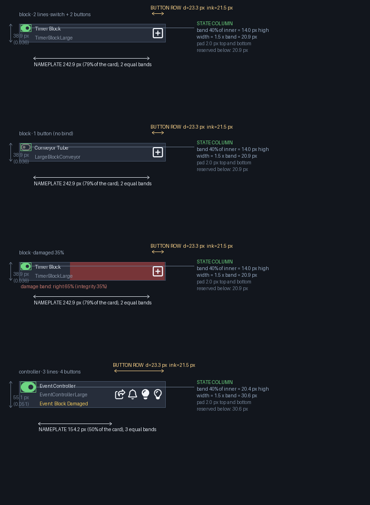

# Компоновка карточки

Одна страница про то, **где что лежит на карточке блока** и каким числом это задано. Нужна
затем, чтобы правка «сдвинь кнопки на два пикселя» или «сделай тумблер крупнее» начиналась с
таблицы, а не с чтения пяти файлов.



Картинка нарисована `tools/icon-atlas/card_layout_preview.py` из тех же констант, что и код, и
скрипт печатает таблицу чисел, которой соответствует рисунок. Если картинка и код разойдутся —
прав код, а рисунок дефектный; перегенерировать: `python tools/icon-atlas/card_layout_preview.py`.

---

## 1. Три части и три вопроса

У карточки три части, и имя у каждой — по вопросу, на который она отвечает
([`06-terminology.md`](06-terminology.md) §4, «Три части карточки»). Сторона в именах не
участвует намеренно: «левая» перестаёт быть правдой при первой же перестановке.

| Часть | Вопрос | Что в ней | Кто владеет геометрией |
|---|---|---|---|
| **колонка состояния** | что блок делает **сейчас** | тумблер питания в верхней полосе; нижняя полоса зарезервирована и пуста | `PortGeometry.TryPowerSwitchRect`, `HitPowerSwitch` |
| **шильдик** | что блок **есть** | имя, подтип и (у контроллера) описание режима — в равных по высоте полосах | `PortGeometry.TryCardTextSpan` |
| **ряд кнопок** | что можно **сделать** со схемой | переход, отслеживание, привязки — от хвостовой границы влево | `PortGeometry.TryCardButtonRow`, `CardButtonRectAt` |

```
        колонка состояния              шильдик                    ряд кнопок
      ┌──────────────────────┬──────────────────────────────┬──────────────────┐
      │ ·2 px·               │                              │                  │
      │  (o=)  питание       │  Имя блока                   │  (>) (#) (T) (F) │
      │  ── 40% внутр. ──    │  Подтип                      │                  │
      │  (резерв)            │  Описание режима             │                  │
      │  ── 60% внутр. ──    │                              │                  │
      │ ·2 px·               │                              │                  │
      └──────────────────────┴──────────────────────────────┴──────────────────┘
       ↑ отступ 4 px           ↑ отступ 5% ширины карточки     ↑ отступ 4 px
       ↑ ширина = 1,5 × высоты                                ↑ центрирован по высоте
```

Части не смешаются: у каждой своё правило размера, поэтому добавление тумблера не сдвинуло
ряд кнопок ни на пиксель, а шильдик просто начался правее ([ADR-0035](adr/0035-block-power-toggle.md)).

**Колонка отступает от карточки со всех четырёх сторон.** По горизонтали — `CardButtonMargin`
(4 px, как у ряда кнопок от противоположного края), по вертикали — `PowerSwitchPadding` (2 px
сверху и 2 px снизу). Внутренняя коробка колонки — это высота карточки минус оба отступа, и
полосы 40/60 делят именно её, а не высоту карточки: иначе нижняя полоса оказалась бы на 4 px
короче своей доли, и правило было бы применено наполовину.

---

## 2. Числа

Все значения — в `VgsConstants`, кроме отмеченных. Единицы — **доли окна**: X — доля ширины,
Y — доля высоты (ADR-0009). Пиксели в таблице — для 1920×1080 при зуме 100%, их печатает скрипт.

### 2.1. Сама карточка

| Что | Константа | Значение | 1080p, зум 1 |
|---|---|---|---|
| Ширина | `NodeWidth` | `0,16` | 307,2 px |
| Высота стандартной карточки | `NodeHeight` | `0,036` | 38,9 px |
| Высота строки режима | `NodeStatusLineHeight` | `0,015` | 16,2 px |
| Высота карточки контроллера | `NodeHeight + NodeStatusLineHeight` | `0,051` | 55,1 px |
| Отступ текста слева | `PortGeometry.CardTextPaddingRatio` | `0,05` **ширины карточки** | 15,4 px |

Высота карточки — **производная**, а не константа: `PortGeometry.CardHeight(node)` возвращает
`NodeHeight` плюс строку, если у узла есть `Controller`. Строка зарезервирована на всю жизнь
контроллера, а не только пока описание непустое: карточка, растущая и сжимающаяся при выборе
события в терминале, двигала бы свой же стек портов под указателем.

### 2.2. Колонка состояния

| Что | Константа | Значение | 1080p, зум 1 |
|---|---|---|---|
| Внутренняя высота | `CardHeight − 2 × PowerSwitchPadding` | — | 34,9 px (блок) / 51,1 px (контроллер) |
| Высота полосы тумблера | `PowerSwitchBandRatio` | `0,40` **внутренней высоты** | 14,0 px / 20,4 px |
| Ширина тумблера | `высота полосы × InkAspect` | `1,5 ×` высоты полосы | 20,9 px / 30,6 px |
| Отступ сверху | `PowerSwitchPadding` | `2 px / 1080` | 2 px |
| Отступ снизу | `PowerSwitchPadding` | `2 px / 1080` | 2 px |
| Отступ от ведущей границы | `CardButtonMargin` | `4 px / 1080` | 4 px |
| Padding попадания | `PowerSwitchHitPadding` | `4 px / 1080` | 4 px |
| Резерв снизу | остаток внутренней высоты | `0,60` внутренней | 20,9 px / 30,6 px |

**Колонка отступает от карточки со всех четырёх сторон.** Горизонтально — тот же `4 px`, что
ряд кнопок держит от противоположного края; вертикально — `2 px` сверху и столько же снизу.
Без вертикального отступа иконка «лежала» на верхней грани и читалась как часть рамки, а не как
контрол на карточке.

**Полосы 40/60 делят внутреннюю коробку, а не карточку.** Требование говорит «доступная высота
уменьшается на 4 условных пикселя» — значит делить надо то, что осталось после отступов. Деление
высоты карточки с последующим отступом оставило бы нижнюю полосу на 4 px короче её доли, то есть
применило бы правило наполовину.

**Отступ — абсолютный, а не доля.** На карточке контроллера (55,1 px) он остаётся теми же 2 px,
поэтому доля внутренней высоты у неё чуть больше — и тумблер там на 3% крупнее относительно
карточки. Это правильно: отступ — это зазор до рамки, а не пропорция.

**Цена — размер тумблера.** Ширина = `1,5 ×` высоты полосы, поэтому два отступа уменьшают и её:
20,9 px против 23,3 px до правки, то есть на ~10%. Тумблер стал на 2% **уже** чернил кнопки ряда
(21,5 px) — в ADR-0035 он был на 9% шире. Это следствие зазора, а не регрессия; вернуть размер
можно поднятием `PowerSwitchBandRatio`, но тогда уйдёт соотношение 40/60 из требования.

### 2.3. Шильдик

| Что | Откуда | Значение |
|---|---|---|
| Левый край без колонки | `NodeWidth × CardTextPaddingRatio` | 5% ширины карточки |
| Левый край с колонкой | `отступ + ширина тумблера + CardButtonTextGap` | см. §3 |
| Правый край | `левый край ряда − CardButtonTextGap` | — |
| Число полос | `2`, у контроллера `3` | равной высоты |

Строки ставятся **делением высоты карточки на число полос**, а не долями от верха: у
контроллера третья строка, и фиксированные доли оставили бы её наполовину вне своей полосы.
Внутри полосы строка стоит на `0,10` её высоты.

Масштабы текста: `NodeTitleScale` `0,56`, `NodeSubtitleScale` `0,44`, `NodeStatusScale` `0,40`.
Все три умножаются на `CardTextScale` — зум, зажатый в `0,55…1,6`; у полос портов свой,
незажатый масштаб (`PortLabelScale`).

### 2.4. Ряд кнопок

| Что | Константа | Значение | 1080p, зум 1 |
|---|---|---|---|
| Диаметр кнопки | `CardButtonDiameter = NodeHeight × CardButtonHeightRatio` | `0,036 × 0,60` | 23,3 px |
| Чернила иконки | `CardButtonIconRatio` | `0,92` диаметра | 21,5 px |
| Зазор между кнопками | `CardButtonGap` | `3 px / 1080` | 3 px |
| Отступ от хвостовой границы | `CardButtonMargin` | `4 px / 1080` | 4 px |
| Зазор до шильдика | `CardButtonTextGap` | `6 px / 1080` | 6 px |
| Допуск попадания | `CardButtonHitTolerance` | `1,35` радиуса | — |

**Диаметр считается от `NodeHeight`, а не от высоты карточки**: у контроллера карточка выше,
кнопки — нет. Это то, что держит кнопки одного размера на всех карточках (ADR-0020).

Ряд прижат вправо и **растёт влево**: `CardButtonRectAt` укладывает кнопки от хвостовой границы
к ведущей. Порядок фиксирован и не зависит от того, какие кнопки у блока есть: **переход →
отслеживание → «да» → «нет» → одиночная привязка** (`PortGeometry.RowOrder`); карточка
показывает подпоследовательность.

### 2.5. Под карточкой

| Что | Константа | Значение |
|---|---|---|
| Ширина полосы порта | `PortBarWidth = NodeWidth` | совпадает с карточкой |
| Высота полосы порта | `PortBarHeight` | `0,018` |
| Высота управления (точка, «x») | `PortControlHeightRatio` | `0,75` высоты полосы |
| Отступ управления от границы | `PortControlMargin` | `4 px / 1080` |
| Padding подписи порта | `PortLabelPadding` | `0,006` |
| Порядок стека | выходы вплотную к карточке, входы под ними, полосы отслеживания — последними | — |

---

## 3. Где в коде

| Файл | Что там |
|---|---|
| `Core/VgsConstants.cs` | **все числа**. Разделы: карточка (`NodeWidth`, `NodeHeight`), кнопки ряда, полосы портов, колонка состояния |
| `Ui/PortGeometry.cs` | **вся арифметика**: `CardRect`, `CardHeight`, `TryCardButtonRow`, `CardButtonRectAt`, `TryPowerSwitchRect`, `TryCardTextSpan`, `TryDamageRect`, `TryPortBarRect`, `HitNode` |
| `Ui/VgsEditorScreen.Draw.cs` | `DrawNode` — порядок отрисовки; `DrawCardButtons`, `DrawPowerSwitch`, `DrawPortBars` |
| `Ui/VgsEditorScreen.Input.cs` | hit-test'ы: `HitTestCardButton`, `HitTestPowerSwitch`, `HitTest` |
| `Ui/VgsIconAtlas.g.cs` | `TextureScale` и `InkAspect` каждой иконки — **сгенерирован**, не править руками |
| `tools/icon-atlas/card_layout_preview.py` | этот рисунок и таблица чисел |
| `tests/OfflineChecks.cs` | утверждения: `CardButtonRow`, `PortControls`, `DamageBand`, `PowerSwitch` |

**Правило:** прямоугольник считается **только** в `PortGeometry`. Отрисовка и hit-test берут один
и тот же прямоугольник, поэтому нарисованное и кликабельное не могут разойтись. Если
прямоугольник понадобился в `DrawNode` — это признак, что его место в `PortGeometry`.

---

## 4. Порядок отрисовки

Порядок — часть компоновки, потому что он решает, что кого перекрывает. `DrawNode`:

1. заливка карточки;
2. **полоса повреждения** — поверх заливки и под всем читаемым, иначе её 50% прозрачности
   смешивались бы с холстом, а не с карточкой;
3. рамка (выделение / наведение);
4. строки шильдика;
5. полосы портов;
6. **ряд кнопок**;
7. **колонка состояния** — последней: она на ведущей границе, и полоса порта соседней карточки,
   нарисованной позже, иначе перекрыла бы контрол.

---

## 5. Как менять

| Хочу | Правлю | Что поедет следом | Проверяю |
|---|---|---|---|
| Карточку шире/выше | `NodeWidth` / `NodeHeight` | всё: ряд, шильдик, порты, рамки групп, авто-раскладка | `offline-check` (геометрия), превью |
| Кнопки крупнее | `CardButtonHeightRatio` | ширина ряда, доля имени, порог аспекта | `CardButtonRow`, `PowerSwitch` (бюджет имени) |
| Тумблер крупнее | `PowerSwitchBandRatio` | высота тумблера, его ширина, отступ шильдика | `PowerSwitch` — там закреплены 40/60 |
| Зазор тумблера от граней | `PowerSwitchPaddingPixels` | внутренняя высота колонки → высота и ширина тумблера → отступ шильдика | `PowerSwitch` — там закреплены 2 px и сумма полос |
| Другую иконку тумблера | `tools/icon-atlas/icons.txt` + SVG | `InkAspect` → ширина колонки | `build-icon-atlas.ps1`, `check-icon-catalog.ps1` |
| Сдвинуть ряд от края | `CardButtonMarginPixels` | левый край ряда, шильдик; **и** `PowerSwitchHitPaddingPixels`, если он должен остаться равным | `PowerSwitch` (соотношение padding/margin) |
| Больше строк на карточке | `NodeStatusLineHeight` + логика `CardHeight` | высота карточки, полосы шильдика, стек портов | `CardButtonRow`, `PowerSwitch` |
| Другой отступ текста | `CardTextPaddingRatio` | левый край шильдика | `CardButtonRow` (пол 30%) |

**После любой правки:**

```powershell
& .\tools\offline-check.ps1                                      # числа и правила
& <python> tools/icon-atlas/card_layout_preview.py               # картинка и таблица
```

Скрипт **читает константы прямо из `VgsConstants.cs`** и считает выражения (`NodeHeight ×
CardButtonHeightRatio`) тем же способом, каким их считает компилятор. Поэтому разойтись с кодом
он не может: если поменять `NodeWidth`, поменяются и картинка, и печатаемая таблица. Это
проверено подстановкой — при `NodeWidth = 0,20` скрипт напечатал 384,0 px и другие проценты
имени.

Единственное, что в нём записано числами, — то, что живёт **в других файлах**: цвета
(`VgsPalette.cs`) и `InkAspect`/`TextureScale` двух иконок (`VgsIconAtlas.g.cs`, генерируется
сборкой иконок). Оба места помечены комментарием с именем файла-источника.

---

## 6. Что где записано

Компоновка — не одно решение, а четыре, и каждое отвечает на свой вопрос. Этот документ их
сводит, но не заменяет:

| Вопрос | Документ |
|---|---|
| Почему ряд кнопок один, справа и одного диаметра | [ADR-0020](adr/0020-card-button-row.md) |
| Почему иконки, а не диски с глифами; почему текстура на иконку | [ADR-0019](adr/0019-icons-atlas.md) |
| Почему полоса повреждения справа и шириной в повреждение | [ADR-0028](adr/0028-block-damage-band.md) |
| Почему колонка состояния, почему 40/60 и откуда ширина | [ADR-0035](adr/0035-block-power-toggle.md) |
| Почему координаты в долях окна и что такое `aspect` | [ADR-0009](adr/0009-screen-coordinate-space.md) |
| Что такое шильдик, колонка состояния, ряд кнопок | [`06-terminology.md`](06-terminology.md) §4 |
| Как устроены классы и слои | [`03-architecture.md`](03-architecture.md) |

---

## 7. Известные ограничения

- **Квадратное окно.** У четырёхкнопочной карточки контроллера с колонкой состояния имя
  занимает 11% ширины — ниже пола 30%, но выше нуля. Пол держится до аспекта **0,79**
  (см. [ADR-0035](adr/0035-block-power-toggle.md) §6). Это принято как цена колонки.
- **Портретное окно.** При аспекте выше ~1,6 ряд занимает всю карточку, и шильдик не рисуется
  вовсе: карточка показывает контролы без текста. Это осознанная деградация, а не сбой.
- **Полоса повреждения перекрывает шильдик.** Она полупрозрачная и лежит под текстом, но на
  сильно повреждённом блоке текст читается хуже — так и было задумано (ADR-0028 §3).
- **Нижняя полоса колонки состояния пуста.** Место зарезервировано под второй контрол; пока его
  нет, `PowerSwitchBandRatio` — это ещё и «сколько осталось свободного».
