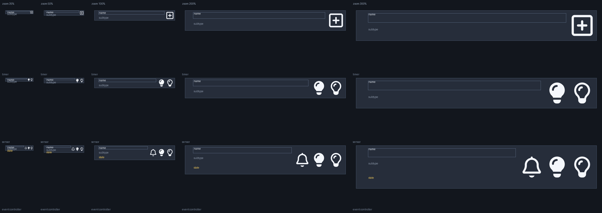

# 0020. Ряд кнопок карточки: все контролы карточки справа, в одну строку, одного размера

- Status: accepted
- Date: 2026-11-22
- Supersedes: —
- Amended by: [0021](0021-jump-to-block-terminal.md) — §2 «диаметр — `NodeHeight · 0,75`»
  **отменяется** (стал `0,60`); §1 порядок ряда **дополняется** кнопкой перехода впереди
  (переход → отслеживание → «да» → «нет» → одиночная привязка); §3 таблица иконок дополняется
  `share-from-square` Regular; §Consequences в части «если появится четвёртая кнопка, менять
  `NodeWidth`, а не размер кнопок» **отменяется** — выбран обратный вариант.
- Amends: [0019](0019-icons-atlas.md) — §5 «Пара «да/нет» остаётся буквами `T`/`F` на
  дисках — сознательно» **отменяется**: пара стала двумя лампами `lightbulb` (Solid —
  «да», Regular — «нет») без дисков. Дополняет [0017](0017-event-controller-watch-ports.md) —
  §1 в части «квадратная кнопка «#» в левой части карточки» **отменяется**: кнопка
  отслеживания — колокольчик `bell` Regular в правом ряду кнопок, как и все остальные.
  Дополняет [0010](0010-port-presentation-and-binding.md) §2b и
  [0011](0011-toolbar-is-the-connection.md) в части вида и расположения кнопок привязки.
  Семантика всех четырёх кнопок, режимы указателя, запись в тулбар и hit-test по смыслу не
  меняются: меняются только вид, размер и место на карточке.
- Joint review: не требовалось — требование (какие иконки, в каких стилях и что все кнопки
  справа в один ряд) пришло от владельца продукта. Противоречия с записанными инвариантами
  нет: «порт рисуется только со связью», «связь — элемент тулбара», «линия отслеживания идёт
  от кнопки» остаются в силе.
- Implementation: **done** (2026-11-22) — `Core/VgsConstants` (константы ряда),
  `Ui/PortGeometry` (`CardButtonKind`, `CardButtonCount`, `TryCardButtonRect`,
  `HitCardButton`, `TryCardButtonRow`, `TryCardTextSpan`), `Ui/VgsEditorScreen` (одна пара
  hover-полей, одна отрисовка `DrawCardButtons`, `IconOf`), `Ui/VgsIconAtlas.g.cs` + текстуры
  (три новые иконки), `tools/icon-atlas/icons.txt`, `tools/build-icon-atlas.ps1` (превью
  каталога, `card_row_preview.py`), `docs/07-icon-catalog.md` (каталог),
  `tools/check-icon-catalog.ps1` (шлюз каталога), `tests/OfflineChecks.cs` (`CardButtonRow`).
  Шлюзы зелёные; приёмка в игре — за человеком (§Verification).
- Revised during implementation (2026-11-22, по результату первого просмотра в игре):
  - **колокольчик перекрашен из жёлтого в общий светлый цвет кнопок.** Жёлтый читался как
    индикатор состояния, а не как кнопка, и был единственным постоянно жёлтым контролом на
    холсте. Жёлтый остался за тем, что действительно является состоянием: описание режима и
    полосы отслеживания (§3);
  - **зазор между кнопками уменьшен с 6 до 3 px.** Ряд выглядел растянутым, а под четвёртую
    кнопку места уже не оставалось (§2, §Consequences).


> Числа этой компоновки, рисунок и «что править, чтобы сдвинуть» собраны в
> [`08-card-layout.md`](../08-card-layout.md).

## Context

### 1. Что было и чем это плохо

К 22 ноября 2026 на карточке было **два независимых места для кнопок и три разных их вида**:

| Кнопка | Где | Вид | Размер |
|---|---|---|---|
| «+» (одна группа) | правый край, по центру | иконка `square-plus` Regular, без диска | диаметр 75% высоты карточки |
| «T» / «F» (две группы) | правый край, **столбиком**, T выше F | инверсный белый диск + буква цветом карточки | радиус 22% высоты карточки, то есть диск **втрое меньше** «+» |
| «#» (event controller) | **левый** край, по центру | инверсный белый **квадрат** + глиф «#» | сторона 75% высоты карточки |

Отсюда три разных дефекта, каждый из которых виден на одном экране:

1. **Один и тот же смысл — разный размер.** Таймер и сенсор рядом: у одного кнопка диаметром
   27 px (на 1080p, зум 1), у другого — 15,8 px. Игрок не знает, что это одна и та же
   кнопка, и не находит её на сенсоре.
2. **Кнопки в двух местах.** У event controller контролы стоят и слева, и справа. Карточка
   читается как два разных элемента, а подпись блока зажата между ними.
3. **Три разных языка формы.** Круг с плюсом, два диска с буквами, квадрат с решёткой. Разница
   в форме должна говорить о разнице в *смысле*, а здесь она говорила о разнице в *истории*
   реализации: каждая кнопка добавлялась отдельно и получала ту форму, которая была удобна
   в тот момент.

Плюс отдельная проблема: **«T» и «F» — это буквы, а не иконки**. Владелец продукта просил
иконки; буква на диске осталась с тех пор, как иконок в проекте не было вовсе (ADR-0019 §5
обосновывал её сохранение именно этим).

### 2. Что попросили

Требование владельца продукта, дословно по смыслу:

- «T» → `lightbulb` **Solid**, «F» → `lightbulb` **Regular**;
- «#» → `bell` **Regular**;
- **все** кнопки карточки (T, F, #, +) — только в правой части карточки, в один
  горизонтальный ряд, по центру карточки по высоте;
- у event controller получается три кнопки в ряд: колокольчик, лампа Solid, лампа Regular;
- у timer block — одна кнопка «+», но **высота у всех кнопок одна**;
- «надо прийти к общей системе: на карточке могут быть кнопки только справа, всё что
  реализовано сейчас — должно быть справа»; набор кнопок зависит от типа игрового блока, как
  и информация на карточке;
- при переносе кнопки отслеживания не забыть, что **от «#» начиналась линия новой связи**.

### 3. Что из этого следует для модели, а не только для картинки

Требование «общая система» — это не про пиксели, а про то, что **кнопка принадлежит
карточке, а не порту и не жесту**. Отсюда решение назвать кнопки по жесту, который они
начинают (`CardButtonKind`), а не по глифу, который они несут. Тогда:

- смена иконки («T» → лампа) не трогает ни геометрию, ни hit-test, ни режимы;
- «какие кнопки у карточки» становится одним вычислением (`CardButtonCount`) вместо двух
  независимых проверок `CanDriveBlocks` и `IsEventController` в трёх местах;
- hover — одно поле на ряд, а не `_hoverPlus` + `_hoverWatch`, которые могли одновременно
  указывать на одну точку и давать две подсветки.

### 4. Что было проверено перед решением

- [ПРОВЕРЕНО] сборкой: `lightbulb` есть в Font Awesome Free 7.3.1 в обоих стилях
  (`svgs/solid/lightbulb.svg`, `svgs/regular/lightbulb.svg`), `bell` — в Regular
  (`svgs/regular/bell.svg`). Все три лежат в `data/fontawesome-free-7.3.1-desktop`, из
  которого берутся и прежние три иконки.
- [ПРОВЕРЕНО] сборкой иконок: все три новых контура растеризуются тем же сборщиком, что и
  прежние (`contours 3 / points 465`, `3 / 433`, `3 / 671`), `TextureScale` = 1,066667 — как у
  всех остальных, потому что нормализация по чернилам одна на всех. Превью — в
  [`docs/icons/`](../icons/).
- [ПРОВЕРЕНО] офлайн-проверками: ряд помещается в карточку на всех четырёх пропорциях
  (0,5625…1,6), кнопки одного диаметра, зазор между соседями равен `CardButtonGap`, а подписи
  остаётся не меньше 30% ширины карточки — включая самую тесную, трёхкнопочную (35% в квадратном окне, 61% на 16:9).
- [НЕ ПРОВЕРЕНО] в игре: как три иконки в ряд читаются на минимальном зуме (0,35). Расчёт
  даёт ≈9,4 px на иконку при 1080p (диаметр 10,2 px × `CardButtonIconRatio` 0,92) — по
  измерению ADR-0019 §6 этого достаточно, чтобы силуэт
  выжил, но «выжил силуэт» и «три иконки различимы» — не одно и то же. Это первый пункт
  приёмки в игре.

## Decision

### 1. Один ряд кнопок на карточке, справа, по центру по высоте

Все контролы, принадлежащие карточке, располагаются в **одном горизонтальном ряду** вдоль
правого края карточки, вертикально центрированном на карточке. Ряд **прижат вправо**: кнопки
укладываются от правой границы карточки влево, поэтому карточка с одной кнопкой сохраняет её
точно там, где «+» был всегда, а карточка с тремя растёт влево.

Порядок кнопок в ряду фиксирован: **отслеживание → «да» → «нет» → одиночная привязка**.
`BindSingle` не встречается вместе с парой (у блока либо одна группа, либо две), поэтому
фактических раскладок три: `[BindSingle]`, `[BindYes, BindNo]`, `[Watch, BindYes, BindNo]`.

Геометрия ряда — единственный источник правды — `PortGeometry.TryCardButtonRect` и
`TryCardButtonRow`; отрисовка и hit-test берут прямоугольники оттуда же, как и для портов.
Граница, по которой обрезается подпись карточки, тоже считается здесь —
`PortGeometry.TryCardTextSpan`: зазор между текстом и рядом задан вертикальной длиной и обязан
пройти через поправку на пропорции, иначе на 16:9 он в 1,8 раза шире задуманного, и подпись
«отъезжает» от ряда тем сильнее, чем шире окно. Это же соображение убрало
`VgsScreenDraw.AspectX`: после отказа от дисков у кнопок не осталось вызывающих в слое
отрисовки, и единственная оставшаяся точка поправки — параметр `aspectX` в `PortGeometry`.

### 2. Один размер у всех кнопок, и он не зависит от высоты карточки

Диаметр — `CardButtonDiameter = NodeHeight · 0.75`, то есть 75% высоты **стандартной**
карточки, а не этой. Карточка контроллера на строку выше, потому что несёт описание режима
(ADR-0017); её кнопки при этом **не растут**. Это и есть унификация из требования: две
карточки рядом показывают кнопки одного размера независимо от того, сколько у них строк
текста и сколько групп срабатывания.

Прежнее правило «кнопка пары масштабируется вместе с карточкой» (ADR-0017 §Verification)
отменено: оно существовало, чтобы пара не выглядела двумя точками на большой подписи, и было
следствием того, что пара была втрое меньше «+». Одинаковый размер снимает причину.

**Зазор между кнопками — 3 px при 1080p** (`CardButtonGapPixels`), то есть меньше отступа от
границы карточки (4 px). Первая редакция ставила 6 px «чтобы соседние кнопки читались как два
контрола»; в игре это оказалось лишним: иконка уже несёт прозрачное поле внутри своей текстуры,
поэтому три пикселя раскладки дают около семи пикселей чистого просвета между двумя значками.
Шесть пикселей растягивали ряд до 44% ширины карточки на четырёх кнопках (16:9), три — до 41%;
разница выглядит мелкой в числах и очевидной на экране, где ряд перестаёт «разъезжаться» к
левому краю. Найдено при приёмке в игре.

**Меньше трёх пикселей — не стоит.** Ряд сжимается примерно на процент ширины карточки, а зазор
перестаёт читаться как зазор. Остаток «воздуха» в ряду из `bell` и `lightbulb` — не эта
константа: эти иконки высокие, и нормировка по высоте чернил делает их узкими (чернила занимают
73–88% ширины кнопки), поэтому две такие рядом показывают больший просвет, чем две квадратные.
Оптическая раскладка такого ряда требует шага **по ширине чернил каждой иконки**, а это заставило
бы геометрию знать, какую иконку рисует кнопка. Этот размен рассмотрен в §Alternatives и не
принят: цена — связь слоя геометрии с таблицей иконок и невозможность проверить ряд без неё.

### 3. Четыре кнопки — четыре иконки, стиль несёт смысл

| Кнопка | `CardButtonKind` | Иконка | Стиль | Почему такой стиль |
|---|---|---|---|---|
| одиночная привязка | `BindSingle` | `square-plus` | Regular | «Привязать» — действие; контурный квадрат с плюсом уже принят в ADR-0019 |
| «да» | `BindYes` | `lightbulb` | **Solid** | Заливка = «этот список срабатывает» |
| «нет» | `BindNo` | `lightbulb` | **Regular** | Контур = «второй вариант того же», а не «ещё одна кнопка» |
| отслеживание | `Watch` | `bell` | Regular | Не действие над блоком, а подписка на его состояние |

Пара «да»/«нет» — **одна иконка в двух стилях**. Это единственный способ показать два
действия в одном месте, не подписывая их буквами: буквы были подписью, теперь подписью стала
заливка. Различить две лампы иначе, чем заливкой, нельзя — любая пара иконок «да/нет» будет
отличаться только подписью, а подпись в 15 px не читается.

**Колокольчик в Regular**, а не в Solid, по той же логике: Solid занят «да», и если бы
колокольчик был Solid, три залитые иконки в ряду читались бы как три равнозначных действия.
Контур отделяет наблюдение от действий.

Цвет — второй носитель смысла, но не на кнопках: **все четыре кнопки ряда светлые**
(`ColPlusFill`) и теплеют до `ColPlusFillHot` под указателем — ровно два состояния, которые
«+» имел всегда. Жёлтый на карточке остаётся за тем, что обозначает **состояние**: описание
режима третьей строкой и полосы отслеживания под карточкой.

Это изменение относительно первой редакции решения. Сначала кнопка отслеживания рисовалась в
цвете наблюдения (`ColWatch`) — по идее «цвет делит ряд на семейства: наблюдение и действие».
В игре это дало обратное: колокольчик оказался единственным постоянно жёлтым контролом на
холсте, и читался как **индикатор** («контроллер что-то отслеживает»), а не как кнопка —
при любом зуме и независимо от того, есть ли у контроллера список. Цвет контрола должен
отвечать на вопрос «что указатель с ним делает», а не «к какому семейству он относится»;
наблюдение уже помечено цветом там, где оно действительно состояние, — на полосах и пунктире.
Найдено при приёмке в игре.

Как это выглядит на реальных размерах: 

Картинка собрана из тех же констант, что компилирует мод, и из тех же текстур, что он
поставляет; пересобрать — `python tools/icon-atlas/card_row_preview.py`. Она показывает
главное, чего не видно в числах: на 35% ряд читается как три разных значка, а не как три
пятна, и подпись карточки остаётся подписью.

### 4. Кнопка — голая иконка, без диска и без квадрата

Диск у «T»/«F» и инверсный квадрат у «#» **убираются**. Диск был носителем контраста для
глифа шрифта, у которого нет своей формы; иконке он не нужен, а рядом с голым кольцом точки
порта и голым крестом удаления читается как второй, чужой элемент. Это ровно та же замена,
которую ADR-0019 §5 уже проделал с «x» на порте, — здесь она распространяется на кнопки
карточки, и теперь у редактора **один** язык: контрол = иконка, цвет = роль, размер = 75%
высоты карточки для кнопок карточки и 75% высоты полосы для контролов порта.

Отсюда следствие: кнопка отслеживания больше **не квадратная**. Квадрат отличал её от круглых
контролов (ADR-0017 §1), но теперь она и так отличается иконкой, цветом и местом в ряду, а
квадрат в ряду одинаковых по размеру иконок был бы единственной несимметричной формой.

### 5. Линия отслеживания по-прежнему начинается от кнопки

Перенос кнопки с левого края в правый ряд **не меняет** начало линии: пока блок не выбран,
порт отслеживания не существует, и линия идёт от центра нажатой кнопки
(`PortGeometry.TryWatchButton` → `DrawPendingWatchLine`). После прикрепления линия уходит от
точки полосы отслеживания, как и раньше (ADR-0017).

Это единственное место, где перенос кнопки мог сломать поведение, и оно закрыто
офлайн-проверкой: `TryWatchButton` обязан возвращать центр кнопки `Watch`, а не какую-либо
другую точку карточки.

### 6. Что происходит при отсутствии текстуры

Ряд не исчезает. Каждая кнопка откатывается на **прежний глиф** — `+`, `T`, `F`, `#` — в том
же цвете и на том же месте (ADR-0019 §6: отсутствие текстуры — единственный разрешённый
откат). Глифы живут в `VgsText` (`SingleButtonGlyph`, `TrueButtonGlyph`, `FalseButtonGlyph`,
`WatchGlyph`), поэтому откат не разбрасывает литералы по экрану.

### 7. Каталог иконок и его шлюз

Иконок стало шесть, и «какая иконка где» перестало быть очевидным из кода: одна и та же
лампа встречается дважды в разных стилях. Поэтому появляется документ-каталог
[`docs/07-icon-catalog.md`](../07-icon-catalog.md) — таблица «изображение · описание ·
идентификатор · где используется» — и **правила его актуализации** вместе со шлюзом
`tools/check-icon-catalog.ps1`, входящим в `offline-check.ps1`.

Шлюз сравнивает наборы в обе стороны: каждый идентификатор манифеста имеет строку в
каталоге (в том же порядке), каждая строка ссылается на существующее превью
`docs/icons/<Id>.png`, каждая иконка где-то рисуется (`VgsIcon.<Id>` в коде вне
сгенерированной таблицы), и в коде нет иконки, которой нет в манифесте. Превью генерируются
сборкой иконок и проверяются её `-Verify` по хешу — то есть каталог не может показать
картинку, которую мод не поставляет.

## Alternatives

| Вариант | Почему отклонён |
|---|---|
| Оставить «T»/«F» буквами, поменять только «#» на колокольчик | Требование владельца продукта прямо называет лампы. Буквы были компромиссом эпохи без иконок, а не решением |
| `lightbulb` Solid для «нет», Regular для «да» | Произвольно и хуже: «да» — основное действие, ему положена плотная заливка |
| Колокольчик Solid | Три залитые иконки в ряду читаются как три равнозначных действия; контур отделяет наблюдение |
| Две разные иконки для «да»/«нет» (например, `check`/`xmark`) | Пара «да/нет» — это один выбор из двух, а не два разных действия; одна иконка в двух стилях читается быстрее, а `xmark` уже занят удалением |
| Ряд по центру карточки, а не прижат вправо | Кнопки «плавали» бы при изменении их числа: у таймера одна кнопка уехала бы в середину. Прижатый ряд оставляет «+» там, где он был |
| Кнопки столбиком справа (как было у пары) | Требование: один горизонтальный ряд. Плюс по вертикали в карточку влезает максимум две кнопки, а у контроллера их три |
| Сохранить прежние размеры (пара втрое меньше «+») | Это и есть дефект, который требование называет «унификация по высоте» |
| Масштабировать кнопки вместе с высотой карточки (как было) | Тогда контроллер и таймер рядом показывают разные размеры — ровно то, что унификация отменяет |
| Отдельный класс `IconButton` с состоянием | У ряда одна геометрия и одно состояние hover; класс добавил бы слой без второй причины для изменения (см. ADR-0019 §Alternatives о том же) |
| Оставить «#» квадратом в ряду | Квадрат отличал её от круглых контролов, когда других отличий не было; в ряду одинаковых иконок он читается как ошибка |
| Каталог иконок без шлюза | Документ, который никто не проверяет, расходится с кодом за один этап — это уже случалось с таблицей вайтлиста (ADR-0008) |
| Хранить каталог как часть `icons.txt` | Манифест — вход сборки, ему нельзя зависеть от документации; каталог — выход, и он читается человеком |
| **Шаг ряда по ширине чернил каждой иконки** (оптическая раскладка: узкие высокие иконки ставились бы ближе) | Ряд выглядел бы ровнее, но геометрия начала бы знать, какая иконка нарисована на кнопке: `PortGeometry` пришлось бы передавать ширины из `VgsIconAtlas`, а `IconOf` — переехать в модель. Это ломает границу «геометрия не знает про `VgsIcon`», из-за которой ряд и hit-test проверяются офлайн без иконок. Выигрыш — 2–4 px просвета на паре; цена — связь слоёв. Отложено: если после приёмки ряд всё ещё читается рыхло, это отдельное решение со своим ADR, а не правка константы |
| Уменьшить зазор ниже 3 px | Ряд сжимается на ~1% ширины карточки (см. §2), а зазор перестаёт читаться. Остаток просвета — собственные поля узких иконок, а не раскладка |

## Consequences

Легко:

- **добавить кнопку на карточку** — один член `CardButtonKind`, одна ветка в
  `HasCardButton`/`CardButtonIndex`, одна строка в `IconOf`; геометрия и hit-test общие;
- **сменить иконку** — одна строка в `IconOf` плюс строка каталога; ни геометрия, ни режимы
  не трогаются (именно это требование и просило);
- **проверить каталог** — `pwsh -File tools/check-icon-catalog.ps1`, входит в
  `offline-check.ps1`;
- **сравнить с игрой** — превью иконок в `docs/icons/` показывают ровно то, что поставляет
  мод, а `-Verify` доказывает, что они не отстали от исходников.

Трудно:

- **ряд занимает правую часть карточки, и у трёхкнопочной карточки подписи остаётся 35%
  ширины в квадратном окне** (61% на 16:9). Длинное имя блока на контроллере обрезается
  раньше, чем на таймере. Это цена требования «все кнопки справа»; смягчение — ряд прижат
  вправо, зазор между кнопками минимальный (3 px при 1080p, см. §2), а подпись обрезается по
  фактической границе ряда (`TryCardButtonRow`), а не по константе. Бюджет проверен на
  четыре кнопки: на 16:9 и 4:3 подписи остаётся 51% и 36% соответственно, в квадратном окне —
  17%, то есть имя вырождается, но не исчезает;
- **четвёртая кнопка в квадратном окне — предел ряда.** Ряд растёт с пропорциями окна
  (кнопка круглая на экране, её ширина = радиус × aspect), поэтому в окне выше, чем шире, три
  кнопки уже съедают подпись, а четыре — вылезли бы за карточку. Это записано утверждением:
  `offline-check` проверяет, что ряд остаётся внутри карточки на всех допустимых пропорциях,
  и что четырёхкнопочный ряд сохраняет подпись на 16:9 и 4:3. Если четвёртая кнопка появится,
  а окна такой формы придётся поддерживать, менять надо ширину карточки (`NodeWidth`), а не
  размер кнопок — иначе унификация размера снова развалится;
  > **Поправка ADR-0021.** Четвёртая кнопка появилась (переход в терминал), и владелец продукта
  > выбрал обратное: уменьшен **размер кнопок** (0,75 → 0,60 высоты карточки), а ширина карточки
  > не тронута, потому что расширение перекладывает раскладку всех уже сохранённых схем. Риск,
  > названный в этом пункте («унификация размера снова развалится»), не наступил: диаметр
  > по-прежнему один для всех кнопок и всех блоков, уменьшился он целиком. Предел ряда не снят, а
  > сдвинут: с пропорций 1,21 до 1,46 по подписи и до 1,62 по самой карточке;
- **три иконки в ряд на минимальном зуме — ≈9,4 px каждая.** По ADR-0019 §6 силуэт выживает,
  но различимость пары «лампа Solid / лампа Regular» на этом размере не измерена — это
  принято как риск и вынесено в приёмку;
- **в ряду стало четыре смысла вместо трёх.** Раньше «#» был один и слева, теперь он часть
  общего ряда; читателю карточки нужно один раз выучить четыре иконки, а не три;
- **каталог — ещё один документ, который надо править в том же изменении.** Смягчение —
  шлюз: забыть строку нельзя, `offline-check` упадёт.

Запрещено:

- ставить контрол карточки где-либо, кроме правого ряда (в частности, слева и столбиком);
- задавать кнопке собственный размер или собственный вертикальный центр;
- масштабировать кнопки вместе с высотой карточки;
- рисовать диск или квадрат позади иконки кнопки;
- считать позицию кнопки в UI — только `PortGeometry`;
- добавлять иконку в манифест без строки в `docs/07-icon-catalog.md` (и наоборот);
- править `docs/icons/*.png` руками — они пересобираются, а `-Verify` сравнивает хеши.

Если решение окажется неверным (например, три иконки в ряд неразличимы на малом зуме),
меняется **только состав ряда**: `CardButtonCount`/`CardButtonIndex` решают, какие кнопки
есть и в каком порядке, `TryCardButtonRect` — где они. Уменьшение диаметра, перенос ряда в
столбик или объединение пары в одну кнопку с всплывающим выбором — правки этих трёх мест
плюс `IconOf`, без изменения режимов указателя и записи в тулбар.

## Verification

Шлюзы (все зелёные на момент реализации):

```powershell
& .\tools\build-icon-atlas.ps1 -Verify   # ICONS UP TO DATE — 14 артефакт(ов), включая превью каталога
& .\tools\check-icon-catalog.ps1         # ICON CATALOG OK — 6 icon(s) listed, previewed and drawn
& .\tools\verify-compile.ps1             # COMPILE OK — 24 file(s)
& .\tools\check-whitelist.ps1            # WHITELIST OK
& .\tools\review-check.ps1               # без находок
& .\tools\offline-check.ps1              # OFFLINE OK — 875 checks
```

Офлайн проверяется то, что решает поведение без игры (`tests/OfflineChecks.cs`,
`CardButtonRow`):

- у таймера одна кнопка, у сенсора две, у контроллера три, у конвейера ни одной;
- у всех кнопок один диаметр — включая кнопки контроллера, чья карточка выше;
- все кнопки центрированы по высоте карточки, то есть лежат в одной строке;
- ряд прижат вправо: правый край последней кнопки — на `CardButtonMargin` от границы
  карточки; соседи разнесены на `CardButtonGap`; ни одна кнопка не выходит за карточку —
  проверено и на всех пропорциях окна (0,5625…1,6), а не только на квадратной;
- подписи остаётся не меньше 30% ширины карточки на всех трёх раскладках, и её правая граница
  считается по `TryCardTextSpan` (один зазор, с поправкой на пропорции);
- **бюджет четвёртой кнопки** — отдельное утверждение на константах, а не на узле: ряд из
  четырёх кнопок сохраняет подписи 30% на 16:9 и 4:3, зазор не больше половины радиуса и не
  меньше пикселя, шаг больше кнопки;
- у контроллера колокольчик левее пары, то есть ряд читается «наблюдение → да → нет»;
- клик в зазор между двумя кнопками попадает в **ближайшую**, а не в первую проверенную;
- угол квадратной иконки `square-plus` нажимается, а точка далеко за кнопкой — промах;
- ширина и отступы кнопки не зависят от пропорций окна (0,5625…1,6), а шаг пары в единицах
  раскладки одинаков на всех пропорциях;
- `TryWatchButton` возвращает центр кнопки отслеживания — точку, от которой идёт линия.

Шлюз каталога проверен подстановкой дефектов — каждый обязан уронить проверку:

| Подмена | Результат |
|---|---|
| удалить строку `Bell` из таблицы | `'Bell' is in tools/icon-atlas/icons.txt but has no row in the catalogue` |
| переименовать `Bell` → `BellX` только в таблице | 4 находки: нет превью, иконка пропала из каталога, лишняя иконка в каталоге, порядок разошёлся |
| сломать ссылку на превью (`icons/NoSuchBell.png`) | `'Bell' must show ` |

Отдельно: `tools/icon-atlas/verify_textures.py` (инструмент, не шлюз) поймал настоящую ошибку
в собственной проверке при добавлении этих трёх иконок. Он сверял **ширину** чернил с
ожидаемой долей стороны, и это проходило только потому, что у всех трёх прежних иконок
чернила были квадратными (512×512, 448×448, 384×384). У `bell` чернила 448×512, у `lightbulb`
384×528 — ширина у каждого своя, а нормируется сборкой **высота**. Проверка переписана на
высоту и дополнена проверкой центрирования чернил и наличия превью каталога. Это пример того,
почему инструмент, сверяющий готовые файлы независимо от сборщика, нужен и после того, как
основные шлюзы зелёные.

Человек в игре (без этого «работает» не считается):

1. **Таймер**: на карточке справа одна иконка `square-plus`; нажатие включает режим привязки,
   линия идёт за курсором.
2. **Сенсор**: справа **две** иконки в ряд — залитая лампа левее, контурная правее. Нажатие
   левой привязывает к списку «да», правой — к «нет»; подсказка в нижней панели называет
   список.
3. **Event controller**: справа **три** иконки в ряд — колокольчик, залитая лампа, контурная
   лампа. Все три светлые, как и на остальных карточках; жёлтыми на карточке остаются только
   описание режима и полосы отслеживания. Слева кнопок нет.
4. Нажатие колокольчика включает режим отслеживания: **пунктирная жёлтая линия начинается от
   центра колокольчика** и идёт к курсору; ЛКМ по блоку добавляет его в список, ПКМ отменяет.
5. **Высота кнопок одинаковая** у таймера, сенсора и контроллера, если поставить их рядом.
6. Кнопки не выходят за карточку и не перекрывают имя блока; у контроллера имя обрезается
   раньше — это ожидаемо. **Зазор между кнопками меньше отступа от границы карточки**, и
   четыре кнопки (если появится четвёртая) ещё помещаются, не съедая имя целиком.
7. Колесо от `MinZoom` до `MaxZoom`: кнопки не меняют форму и не разъезжаются; на минимальном
   зуме три иконки в ряд **различимы** (главный риск §Consequences).
8. Смена разрешения при открытом редакторе: ряд не съезжает, отступ от правой границы
   остаётся те же 4 px, кнопки остаются круглыми.
9. Все четыре иконки светлые; под указателем теплеет **только та кнопка, на которую он
   наведён**, остальные остаются светлыми.
10. В логе нет `could not` / `prohibited`; есть строка `[VGS] icons ready (6 texture(s) ...)`.
