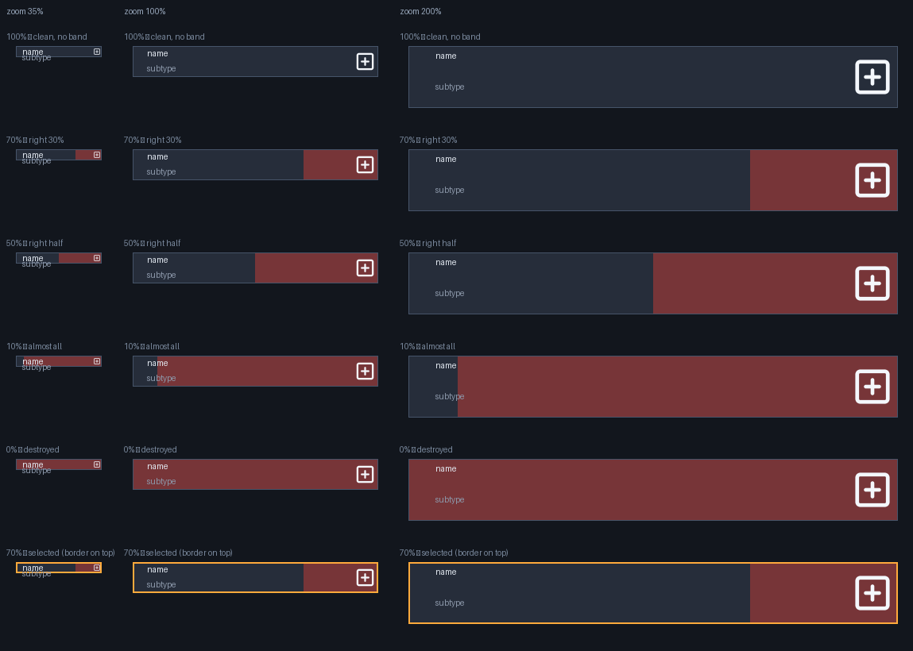

# 0028. Повреждение блока — красная полоса справа на карточке, шириной в повреждение

- Status: accepted
- Date: 2026-11-23
- Supersedes: —
- Amends: [0020](0020-card-button-row.md) — в части «на карточке только подпись и ряд кнопок»:
  у карточки появляется ещё один элемент — полоса повреждения. Раскладка ряда, размеры и
  hit-test кнопок **не меняются**: полоса рисуется под ними и не является контролом.
  Дополняет [0003](0003-layering.md) в части «состояние читается из снимка, а не из мира»:
  индикатор берёт значение из `Node.State`, а не из блока.
- Joint review: не требовалось — требование (что именно показывать и как) пришло от владельца
  продукта. Противоречия с записанными инвариантами нет: «Ui не читает мир при рисовании»
  соблюдено, новых аллокаций в кадровом пути нет, ни одна связь, порт или режим не затронуты.
- Implementation: **done** (2026-11-23) — `Model/BlockState` (`Integrity`, `IsDamaged`),
  `Ui/PortGeometry.TryDamageRect` и `FitDamageBand`, `Ui/VgsEditorScreen` (`ColDamage`, отрисовка
  в `DrawNode`), `tests/OfflineChecks.cs` (`DamageBand`). Шлюзы зелёные; приёмка в игре — за
  человеком (§Verification).
- Revised during implementation (2026-11-24, по результату первого просмотра в игре):
  - **полоса рисовалась на всю ширину экрана.** Защита от субпиксельной ширины сравнивала
    нормализованную ширину с `1f` — то есть с целым экраном, а не с пикселем, — поэтому условие
    было истинно всегда, и каждая повреждённая карточка получала полосу шириной в экран.
    Правило вынесено в `PortGeometry.FitDamageBand` (графовые единицы, зажим по карточке) и
    покрыто офлайн-утверждениями: в слое отрисовки его нельзя было проверить, а значит и
    поймать до игры;
  - **подтверждено, что порога по величине повреждения нет.** «70%» и «50%» из требования —
    примеры доли, а не уровни включения; в §Decision это сказано явно, чтобы трактовку нельзя
    было вернуть;
  - **пауза отменена** — см. [ADR-0029](0029-editor-does-not-pause.md): пока мир стоял, урон
    было негде получить, и индикатор нечего было показывать.

## Context

### 1. Что было

Снимок состояния блока (Шаг 2 плана организации кода) уже заполнялся: `Node.State.Integrity`
обновлялся дважды в секунду по видимым карточкам. Но **ничего его не показывало**: игрок видел
ту же карточку, что и до появления снимка, и не мог понять, цел ли блок, не открывая терминал.
Снимок без потребителя — это код, который нельзя проверить ни глазами, ни регрессом.

### 2. Что попросили

Требование владельца продукта, дословно по смыслу:

- если блок **не повреждён** — карточка выглядит как сейчас, без изменений;
- если целостность, например, **70%** — правая часть карточки окрашивается красным;
- если **50%** — правая **половина**;
- красный — **прозрачность 50%**, **под кнопками и текстом**.

### 3. Что из этого следует, а что — нет

Из требования следуют три правила, и два из них — не про пиксели:

1. **Ширина полосы — это повреждение, а не целостность.** 70% целостности → 30% карточки
   красное; 50% → половина. Обратное прочтение («ширина = целостность») дало бы 50% и там и
   там, но на 70% нарисовало бы 70% красного — то есть карточка краснела бы по мере
   *починки* блока. Одна и та же дробь, сказанная наоборот.
2. **Полоса прижата к правому краю**, а не к левому и не по центру: карточка «съедается» с
   одной стороны, и это читается без легенды.
3. **Полоса — состояние, а не контрол.** У неё нет hit-test, она не участвует в режимах
   указателя, и она не должна ловить клики — иначе клик по правой части карточки перестал бы
   выбирать блок.

## Decision

### 1. Полоса справа, ширина = 1 − Integrity, во всю высоту карточки

```
целостность 100%          [ имя блока            ● ● ● ]
целостность  70%          [ имя блока      ▓▓▓ ● ● ● ]
целостность  50%          [ имя бло▓▓▓▓▓▓▓▓ ● ● ● ]
целостность  10%          [ ▓▓▓▓▓▓▓▓▓▓▓▓▓▓▓ ● ● ● ]
```

Геометрия — единственный источник правды — `PortGeometry.TryDamageRect(node, out topLeft,
out size)`, в тех же единицах графа, что и `CardRect`. Отрисовка переводит результат в экран
тем же `_zoom`, что и всё остальное на карточке, поэтому полоса не может «отклеиться» от
карточки при зуме или панораме.

**Порога нет: сколько процентов повреждения — столько и красного.** 1% — тонкая полоска, 7% —
полоска в семь раз шире, 73% — почти вся карточка. Единственное значение, которое не рисует
ничего, — целостность 1 (в пределах допуска). «70%» и «50%» в требовании были **примерами
доли**, а не уровнями, на которых индикатор включается; трактовать их как порог — значит
показывать пустую карточку у блока с 30% повреждения, то есть именно там, где индикатор нужнее
всего.

**Один пиксель экрана — нижняя граница ширины, и это предел отрисовки, а не смысла.** Спрайт
шириной меньше пикселя растеризуется ненадёжно (`MyScreenSpaceSprite.Draw` не округляет размер
сам — он передаёт его в `RectangleF` как есть, а дальше решает растеризатор). Поэтому при
ширине меньше 1 px полоса расширяется до 1 px и прижимается к правому краю. Направление
погрешности выбрано осознанно: **индикатор может преувеличить повреждение на пиксель, но не
может скрыть его.** Обратный округление (в ноль) сделало бы блок с 1% повреждения неотличимым
от целого — ровно та ошибка, которую этот индикатор обязан не совершать.

**Высота — карточки, а не `NodeHeight`.** Карточка контроллера на строку выше (ADR-0017), и
полоса, посчитанная по стандартной высоте, остановилась бы на строку раньше именно на самых
высоких карточках.

**Полосы портов под карточкой не красятся.** Карточка — это то, чем блок *является*; полосы
портов — то, что он *делает*. Повреждение отвечает на первый вопрос, и красить чужие полосы
значило бы сказать, что связь повреждена.

Как это выглядит на реальных размерах: 

Картинка собрана из тех же констант, что компилирует мод, и из тех же текстур, что он
поставляет; пересобрать — `python tools/icon-atlas/damage_band_preview.py`. Она показывает
главное, чего не видно в числах: полупрозрачный красный не съедает ни подпись, ни ряд кнопок,
а граница полосы остаётся резкой на всём диапазоне зума.

### 2. Рисуется под всем, что игрок читает

Порядок в `DrawNode` фиксирован:

```
заливка карточки → ПОЛОСА ПОВРЕЖДЕНИЯ → рамка → подписи → полосы портов → кнопки
```

Полоса **после заливки**: она композитится поверх непрозрачного фона карточки, иначе её
50% прозрачности смешались бы с холстом и дали бы другой цвет на каждой карточке. Полоса
**до рамки**: рамка несёт выбор и наведение (`ColNodeSelected` / `ColNodeHover`), и красная
полоса поверх неё сделала бы выделенную карточку похожей на невыделенную ровно в тот момент,
когда игрок на неё смотрит. Полоса **до подписей, портов и кнопок** — это прямое требование
(«под кнопками и текстом»).

### 3. Полупрозрачный красный, а не заливка и не рамка

`ColDamage = (200, 60, 55, 128)` — 50% непрозрачности. Поверх заливки карточки `(38,45,58)`
это даёт ≈ `(119,52,56)`: красный читается, но остаётся тёмным, и светлые подписи
(`ColText`, `ColTextDim`) на нём не теряются.

Отвергнутые варианты формы:

| Вариант | Почему отклонён |
|---|---|
| Включать индикатор только от какого-то процента (10–30%) | «70%» и «50%» в требовании — примеры доли, а не пороги. Порог спрятал бы повреждение у блока, который уже разбит на треть, — там индикатор и нужен |
| Красить всю карточку с прозрачностью = повреждению | Не различает «слегка задет» и «вдребезги»: у 90% и у 10% целостности это два оттенка одного цвета, а требование просит показывать **долю** |
| Менять цвет рамки карточки на красный | Рамка уже несёт два смысла — выбор и наведение (ADR-0014, ADR-0020). Третий смысл в том же месте сделал бы выделение неотличимым от повреждения |
| Красная полоска-подчёркивание по нижней грани | Не показывает долю: длина и так занята шириной карточки, а толщина в 2–3 px на малом зуме исчезает |
| Градиент (затухание к левому краю) | Доля перестаёт читаться как граница: где кончается повреждение, не видно. Резкая граница — это и есть «сколько осталось» |
| Число «70%» на карточке | Требует форматирования строки в кадровом пути — прямая аллокация на кадр на карточку (R010), ради цифры, которую на малом зуме не прочитать. Число уместно в меню узла (Этап 5.4), а не на карточке |

### 4. Порог «повреждён» берётся у состояния, а не заводится второй

`PortGeometry.TryDamageRect` спрашивает `BlockState.IsDamaged`, то есть тот же допуск
`IntegrityTolerance`, что и весь остальной код. Второй порог в геометрии разошёлся бы с первым
на первой же правке, и карточка показывала бы полосу у блока, который код считает целым.

### 5. У группы полосы нет

Узел-группа тоже носит `BlockState` (правило «у каждого узла есть состояние»), но группы — не
блок: у неё нет ни `EntityId`, ни целостности. `TryDamageRect` возвращает `false` для группы,
и это отдельное утверждение офлайн-проверок, а не побочный эффект.

## Consequences

Легко:

- **поменять цвет или прозрачность** — одна константа `ColDamage` в палитре экрана;
- **поменять сторону полосы** — одна строка в `TryDamageRect`; отрисовка не изменится, потому
  что берёт готовый прямоугольник;
- **добавить частные показатели** (заряд, заполненность, Этап 5.2) — по той же схеме: правило
  в `PortGeometry`, значение из `BlockState.Metrics`, отрисовка в `DrawNode`. Механика полосы
  уже проверена офлайн;
- **проверить правило** — `pwsh -File tools/offline-check.ps1`, раздел «damage band on the
  card».

Трудно:

- **полоса идёт под кнопками, а кнопки занимают правый край** — на сильно повреждённом блоке
  красный фон оказывается ровно под рядом кнопок. Это принято: кнопки рисуются поверх и
  остаются светлыми, а игрок читает и «блок разбит», и «сюда можно нажать». Обратный порядок
  (полоса поверх кнопок) сделал бы контролы нечитаемыми именно на тех карточках, где игрок
  чаще всего и работает;
- **красный — единственный цвет, который теперь означает «плохо»**, и он же используется для
  отказа отслеживания (`ColWatchError`) и предупреждений в нижней панели. Разница в носителе:
  там красный у линии и у текста, здесь — у заливки карточки. Если появится третий смысл,
  менять надо будет именно этот выбор, а не добавлять четвёртый оттенок красного;
- **полоса не показывает, что именно повреждено** — только сколько. Для «какой блок чинить
  первым» этого достаточно; подробности — в терминале.

Запрещено:

- считать прямоугольник полосы в слое отрисовки (только `PortGeometry.TryDamageRect`);
- заводить второй порог «повреждён» помимо `BlockState.IsDamaged`;
- вводить порог по величине повреждения («показывать от N%») — это отменяет саму задачу;
- округлять ширину полосы вниз (до нуля) — тонкое повреждение обязано быть видно;
- рисовать полосу поверх рамки, подписей, полос портов или кнопок;
- красить полосы портов и рамку группы;
- форматировать число или проценты в `DrawNode`.

## Note: пауза отменена — индикатор виден живым

Изначально экран ставил игру на паузу (`PausesGameInSinglePlayer = true`), и примечание здесь
гласило, что расти полоса на глазах не может. **Это отменено** [ADR-0029](0029-editor-does-not-pause.md):
пауза останавливала симуляцию, поэтому повреждение было нельзя увидеть растущим, а
уничтоженные и построенные блоки — появившимися. Теперь мир при открытом редакторе живёт, и
индикатор показывает живое значение.

Проход состояния работал и на паузе (экранный `OnUpdate` вызывается GUI-хостом без гейта паузы,
[`01-research/api-terminal-search.md`](../01-research/api-terminal-search.md) §2.5) — он читает
то повреждение, которое уже есть. Проблема была не в проходе, а в том, что урону негде было
случиться.

Если полосы не видно, лог отвечает на вопрос быстрее глаза: строка
`state pass: N of M visible card(s) read, K damaged` пишется один раз за сессию и разделяет три
причины, которые на экране выглядят одинаково:

| Строка в логе | Что это значит |
|---|---|
| строки нет вовсе | проход состояния не доходит до экрана — дефект, а не отсутствие повреждений |
| `N = 0` | на холсте нет карточек (всё за пределами кадра) |
| `K = 0` | значения читаются, но блоки целые |
| `K > 0`, полосы нет | дефект отрисовки |

## Verification

Шлюзы (все зелёные на момент реализации):

```powershell
& .\tools\verify-compile.ps1    # COMPILE OK — 32 file(s), 0 warning(s)
& .\tools\check-whitelist.ps1   # WHITELIST OK — 158 distinct type reference(s)
& .\tools\review-check.ps1      # REVIEW OK — no findings
& .\tools\offline-check.ps1     # OFFLINE OK — 1296 checks
```

Офлайн проверяется то, что решает картинку без игры (`tests/OfflineChecks.cs`, `DamageBand`,
30 утверждений):

- целая карточка полосы не имеет вовсе;
- 70% целостности → ширина 30% карточки; 50% → ровно половина; 0% → вся карточка;
- полоса заканчивается на правом краю карточки и начинается там, где кончается целая часть;
- высота — высота карточки: от её верхнего края до нижнего, включая карточку контроллера,
  которая на строку выше; полосы портов под карточкой в высоту не входят;
- порог берётся у `BlockState.IsDamaged`: блок, сваренный в пределах допуска, полосы не имеет;
- у группы полосы нет, даже если её состоянию записали целостность;
- **полоса никогда не выходит за карточку**: нижняя граница ширины расширяет её вправо и не
  сдвигает левый край за пределы карточки, граница шире карточки зажимается до карточки, у
  уничтоженного блока полоса равна карточке ровно.

Шлюз проверен подстановкой дефектов — каждый обязан уронить проверку:

| Подмена | Результат |
|---|---|
| `damage = 1f - Integrity` → `damage = Integrity` (ширина = целостность) | `OFFLINE FAILED — 4 of 1296`: ширина, левая граница, «у уничтоженного блока полосы нет», «0% красит всю карточку» |
| убрать проверку `node.IsGroup` | `OFFLINE FAILED — 1 of 1296`: «a group never shows a damage band» |
| убрать зажим `width > cardSize.X` в `FitDamageBand` | `OFFLINE FAILED — 2 of 1296`: «a floor wider than the card is clamped to the card», «the clamped band starts at the card's left edge» |

Человек в игре (без этого «работает» не считается):

1. **Целый блок**: карточка выглядит точно как до изменения — ни полосы, ни намёка на неё.
2. **Повреждённый блок**: подстрелить блок до ≈70% — справа появляется красная полоса
   примерно на треть карточки, полупрозрачная; имя и тип блока читаются.
3. **Половина**: добить до ≈50% — полоса занимает ровно правую половину.
4. **Сильно повреждён**: у 10% целостности карточка почти вся красная, но кнопки в правом
   ряду остаются светлыми и нажимаются.
5. **Живость**: стоять на схеме, пока блок получает урон — полоса растёт не чаще двух раз в
   секунду, без мигания и без «прыжков» карточки.
6. **Порты и кнопки**: полосы портов под карточкой и рамка выделения/наведения не краснеют.
7. **Зум и панорама**: на всём диапазоне `MinZoom`…`MaxZoom` полоса прижата к правому краю
   карточки и не отклеивается при перетаскивании.
8. **Группа**: у рамки группы полосы нет никогда.
9. **Поиск**: карточка, не совпавшая с запросом, вместе с полосой уходит в прозрачность
   (`SearchDimOpacity`) — полоса не остаётся единственным ярким элементом на призраке.
10. В логе нет `could not` / `prohibited`; теги `state-integrity` и `screenstate` не появляются.
